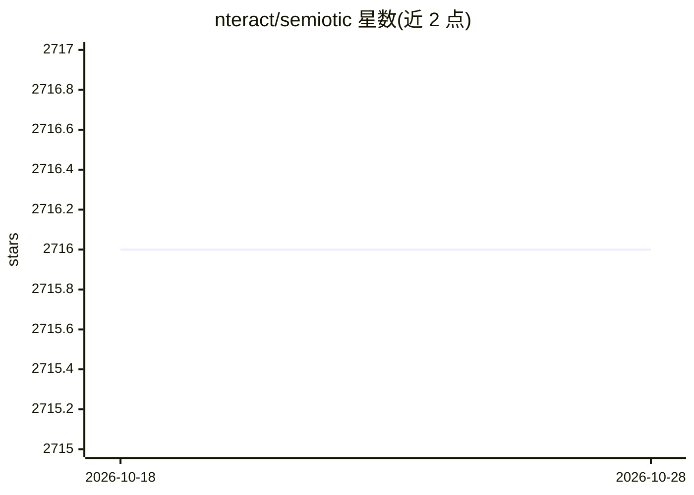

# nteract/semiotic

⭐ 2,716 · TypeScript · Apache-2.0 · 推送 2026-10-28 · [GitHub](https://github.com/nteract/semiotic) · [官网](https://semiotic.nteract.io) · 组织维护

**面向 AI 辅助开发的 React 数据可视化库**

nteract 维护的 React 图表库，覆盖 XY、分类、网络图、地理、实时流式与联动视图等 6 类 60 余个组件；实时图表以 canvas 60fps 渲染并支持 ref 推送 API。面向需要在前端嵌入复杂可视化的开发者，AI 定位是辅助开发：提供 semiotic/ai 能力目录、机器可读 schema、MCP 服务器（npx semiotic-mcp）、CLI doctor 校验与 anti-pattern 诊断，供编码助手生成和修复图表配置。需 React 18.1+/19，npm 安装。限制：不保证 AI 一次生成正确；超大规模点渲染场景建议其他库。

## 筛选速览

| 维度 | 判定 | 备注 |
|---|---|---|
| AI 角色 | `ai-enhanced` | 去掉 AI 部分产品仍成立 |
| 许可风险 | `permissive` | Apache-2.0 |
| 部署形态 | `library` | 以包/库形式分发 |
| 模型依赖 | — | README 未给出锁定关系 |
| 硬件要求 | — | 无带数字的原话,不猜 |
| 安装摩擦 | `low` | 无编译、无系统依赖或容器化 |
| 成熟度 | — | 结构信号不足 |

## 能力要点

- 41 个稳定入口、60+ 图表组件（XY/分类/网络/地理/实时/联动）
- MCP 服务器 + CLI doctor + diagnoseConfig 用于生成/校验/修复图表配置
- 实时流式图表 canvas 60fps 渲染，带 decay/pulse/staleness 编码
- Vega-Lite spec 可经 fromVegaLite 转换为 Semiotic 配置

## 适用场景

- 在 React 应用中嵌入网络图、实时监控流式图表与联动视图
- 让编码助手（MCP 客户端/Copilot/Claude）按 schema 生成并自动校验图表代码
- 将笔记本或 AI 生成的 Vega-Lite 规格转换为 React 图表组件

## 场景标签

 · 领域:前端数据可视化

## 证据(README 行号)

> L12: A React data visualization library designed for AI-assisted development and streaming data.
> L49: Semiotic provides a workflow for generating, checking and repairing chart

## 星数曲线

2026-10-18 2,716 → 2026-10-28 2,716（+0）

---
*卡片 v1 · prompt 1.4 · 生成 2026-10-21 · 置信度 high · 依据 README sha `7cd1364f4b8c` · [字段定义](../../DATASET.md)*
