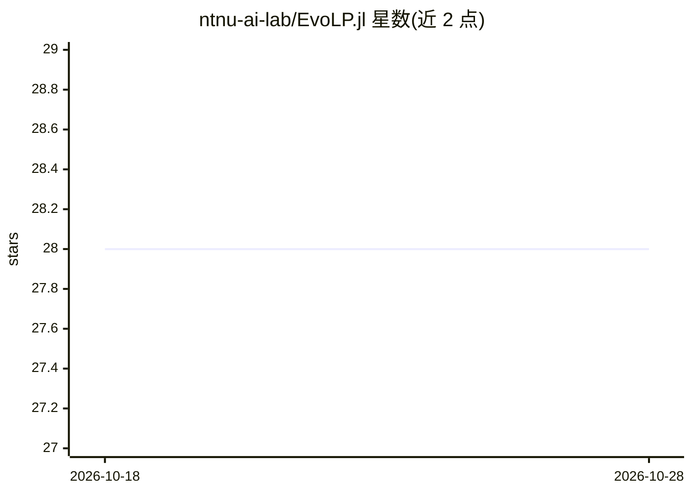

# ntnu-ai-lab/EvoLP.jl

⭐ 28 · Julia · MIT · 推送 2026-09-26 · [GitHub](https://github.com/ntnu-ai-lab/EvoLP.jl) · [官网](https://ntnu-ai-lab.github.io/EvoLP.jl/) · 组织维护

**Julia 进化计算实验场：积木式构建优化算法**

Julia 语言的进化计算工具库：提供随机种群生成器、父代选择算子、多种交叉与变异方法、基准测试函数、结果报告与统计日志簿等预定义积木，可组合成自定义算法，或直接使用内置的 GA、1+1EA、PSO 极小化器；支持通过 MPI.jl 扩展实现并行化与岛屿模型。面向优化任务（离散、连续、组合），主要供科研与教学使用，起源于 NTNU 博士生的内部工具箱，附有会议论文可引用。

## 筛选速览

| 维度 | 判定 | 备注 |
|---|---|---|
| AI 角色 | `ai-native` | 本体是模型或模型工具 |
| 许可风险 | `permissive` | MIT |
| 部署形态 | `None` |  |
| 模型依赖 | — | README 未给出锁定关系 |
| 硬件要求 | — | 无带数字的原话,不猜 |
| 安装摩擦 | `low` | 无编译、无系统依赖或容器化 |
| 成熟度 | — | 结构信号不足 |

## 能力要点

- 随机种群生成、选择、交叉、变异等可组合积木
- 内置 GA、1+1EA、PSO 极小化器
- MPI.jl 扩展支持并行化与岛屿模型
- 统计日志簿与基准测试函数

## 适用场景

- 组合积木快速搭建进化算法求解优化问题
- 教学或研究中实验 GA/PSO 等算法
- 基准测试函数上对比优化器表现

## 场景标签

`科研工具` · 领域:学习与行业

## 证据(README 行号)

> L9: **EvoLP.jl** is a _playground_ for evolutionary computation in Julia. It provides a set of predefined _building bloc
> L20: Combine these blocks to make your own algorithms or use some of the included minimisers: GA, 1+1EA and PSO.
> L75: EvoLP.jl started as a toolbox for internal use by PhD students of NTNU's Open AI Lab, and whose funding is provided

## 星数曲线

2026-10-18 28 → 2026-10-28 28（+0）

---
*卡片 v1 · prompt 1.4 · 生成 2026-10-26 · 置信度 high · 依据 README sha `6b9bf98b312d` · [字段定义](../../DATASET.md)*
