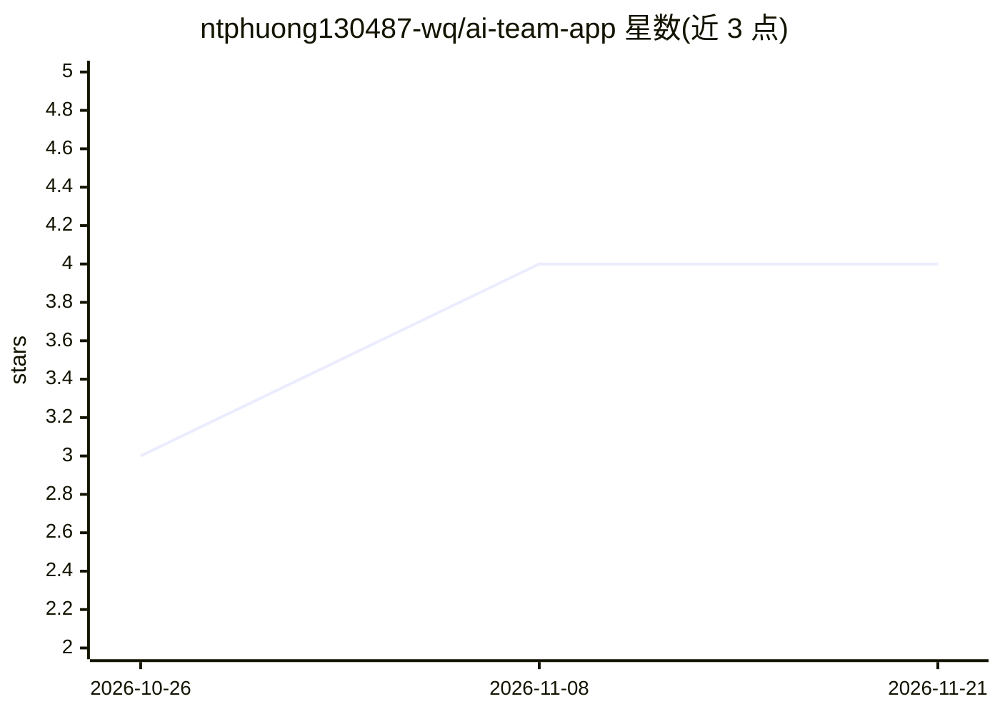

# ntphuong130487-wq/ai-team-app

⭐ 4 · JavaScript · MIT · 推送 2026-10-28 · [GitHub](https://github.com/ntphuong130487-wq/ai-team-app) · [官网](https://ntphuong130487-wq.github.io/ai-team-app/) · 个人维护

**在浏览器中协调多个 AI 助手协作完成任务的人工审批看板**

一个单页静态 HTML 应用，将一项任务拆分为 Director、Workers、Leader、独立 QA 等角色，由用户在两个人工审批关口（批准计划、定稿结案）之间推动流程。应用自动生成每一步提示词并复制到剪贴板、打开对应的 AI 聊天界面，用户将回复粘贴回来继续下一步。数据仅存于浏览器 localStorage，支持 JSON 导出导入、SHA-256 封存、Markdown/PDF 报告导出，提供 10 种界面语言。不使用 API key，依赖用户已有的 AI 订阅账户。

## 筛选速览

| 维度 | 判定 | 备注 |
|---|---|---|
| AI 角色 | `ai-native` | 本体是模型或模型工具 |
| 许可风险 | `permissive` | MIT |
| 部署形态 | `library` | 以包/库形式分发 |
| 模型依赖 | — | README 未给出锁定关系 |
| 硬件要求 | — | 无带数字的原话,不猜 |
| 安装摩擦 | `low` | 无编译、无系统依赖或容器化 |
| 成熟度 | — | 结构信号不足 |

## 能力要点

- 角色分工流程：Director 拆分任务、Worker 执行、独立 QA 校验（FAIL 锁定该轮）
- 自动生成并复制每步提示词，粘贴回复后自动识别所属步骤
- 结案记录以 SHA-256 封存，不可编辑，需另立后续案件复审
- 内置 DLP 警告与数据分类，机密案件禁用免费档 AI

## 适用场景

- 对提案、合同、投资建议做多 AI 交叉评估
- 生成带审计记录的合规/内控评估报告
- 对多个来源做研究综述并附引用

## 场景标签

`多智能体` `AI 助手` · 领域:Agent 开发

## 证据(README 行号)

> L3: **Make several AI assistants work on one case together, with you approving at two gates. It runs in your browser, us
> L35: - **Zero install, zero API.** A single static HTML page. It works with the free or paid chat plans you already have

## 星数曲线

2026-10-26 3 → 2026-11-21 4（+1）

---
*卡片 v1 · prompt 1.4 · 生成 2026-11-21 · 置信度 mid · 依据 README sha `3409b6b995bd` · [字段定义](../../DATASET.md)*
