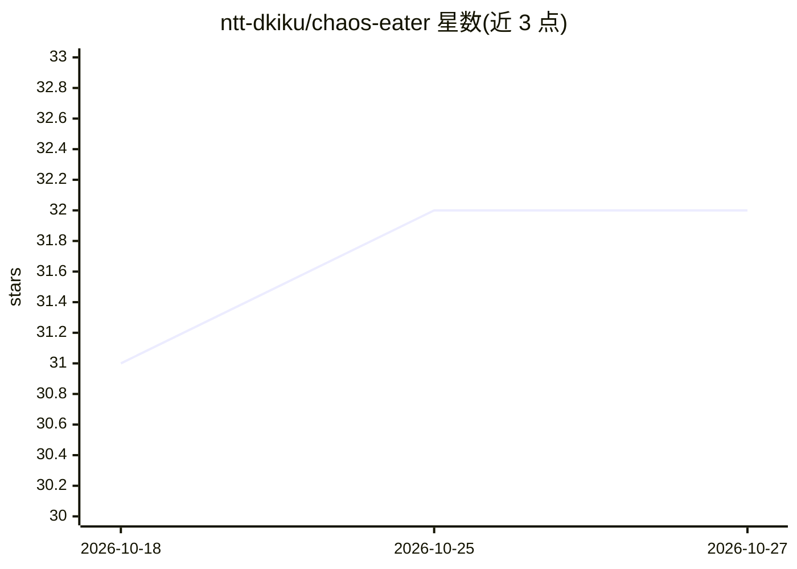

# ntt-dkiku/chaos-eater

⭐ 32 · Python · NOASSERTION · 推送 2026-04-06 · [GitHub](https://github.com/ntt-dkiku/chaos-eater) · [官网](https://ntt-dkiku.github.io/chaos-eater/) · 组织维护

**用 LLM agent 全自动完成 Kubernetes 混沌工程循环的系统**

ASE 2025 NIER 论文官方实现：将混沌工程（CE）的假设、实验、分析、改进四阶段预定义为 agentic workflow，由 LLM agent 分工完成需求定义、测试规划、调试等任务，在 Kubernetes（kind）集群上自动执行混沌实验并对系统做韧性改进。通过 Docker 与 Make 以 sandbox/standard 两种模式启动，提供浏览器 GUI（聊天式），输入为压缩的 Skaffold 项目。支持 GPT/Gemini/Claude/Ollama，但声明除 GPT-4o 外行为可能不稳定；README 标注为实验性实现，不适用于生产环境。

## 筛选速览

| 维度 | 判定 | 备注 |
|---|---|---|
| AI 角色 | `ai-native` | 本体是模型或模型工具 |
| 许可风险 | `none` | NOASSERTION |
| 部署形态 | `None` |  |
| 模型依赖 | local-ok | 支持本地模型 |
| 硬件要求 | — | 无带数字的原话,不猜 |
| 安装摩擦 | `low` | 无编译、无系统依赖或容器化 |
| 成熟度 | `idea` | |

## 能力要点

- 按 CE 四阶段（假设/实验/分析/改进）预定义 agentic workflow，LLM agent 自主完成循环
- 提供浏览器 GUI，上传 Skaffold 项目文件夹即可自动运行混沌工程循环
- 支持 GPT、Gemini、Claude 与本地 LLM（Ollama），可自定义模型
- sandbox 模式将 K8s 集群与应用全部容器化，不改宿主环境

## 适用场景

- 我在 Kubernetes 上部署的微服务想自动发现并修复韧性缺陷
- 我想低成本跑通完整的混沌工程循环而不手工设计实验
- 我想复现论文中的混沌工程自动化实验结果

## 场景标签

 · 领域:软件工程/AIOps

## 证据(README 行号)

> L8:  ChaosEater is an LLM-based system that ***fully*** automates the Chaos Engineering (CE) cycle in Kubernetes systems
> L10:  ChaosEater pre-defines its agentic workflow according to the systematic CE cycle and assigns subdivided operations
> L11:  These LLM agents autonomously complete the CE cycle through several software engineering tasks, such as requiremen

## 星数曲线

2026-10-18 31 → 2026-10-27 32（+1）

---
*卡片 v1 · prompt 1.4 · 生成 2026-10-25 · 置信度 high · 依据 README sha `b7d933fcb849` · [字段定义](../../DATASET.md)*
