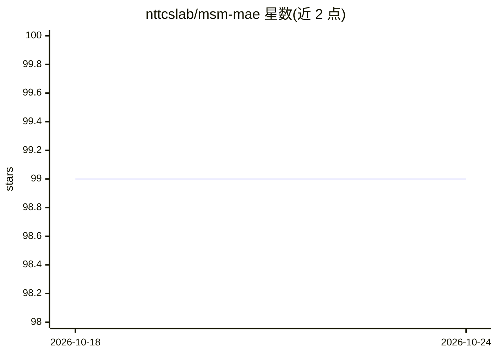

# nttcslab/msm-mae

⭐ 99 · Jupyter Notebook · NOASSERTION · 推送 2026-02-20 · [GitHub](https://github.com/nttcslab/msm-mae) · [官网](https://proceedings.mlr.press/v166/niizumi22a.html) · 组织维护

**音频自监督表征学习 MSM-MAE 的参考实现与预训练权重**

NTT CS Lab 发布的 Masked Spectrogram Modeling using Masked Autoencoders（MSM-MAE）原始实现：一种面向通用音频表征的自监督学习方法，包含用任意音频文件做预训练的训练代码、在 HEAR 2021 与 EVAR 两个基准上评测的代码、可视化 notebook 与三个预训练权重。提供 RuntimeMAE 工具加载模型并对音频编码，支持逐层特征输出。README 顶部声明已有后继实现 M2D，新项目建议改用 M2D，本仓库作为论文的参考实现保留。安装需从 facebookresearch/mae 下载源文件并打补丁，配合 conda 环境与 requirements.txt。

## 筛选速览

| 维度 | 判定 | 备注 |
|---|---|---|
| AI 角色 | `ai-native` | 本体是模型或模型工具 |
| 许可风险 | `none` | NOASSERTION |
| 部署形态 | `desktop` | 安装包/桌面程序 |
| 模型依赖 | — | README 未给出锁定关系 |
| 硬件要求 | — | 无带数字的原话,不猜 |
| 安装摩擦 | `medium` | 含编译或系统依赖之一 |
| 成熟度 | — | 结构信号不足 |

## 能力要点

- 基于掩码自编码器的音频自监督预训练（log-mel 频谱图）
- 支持 HEAR 2021 与 EVAR 基准评测
- RuntimeMAE 加载预训练模型对任意音频编码，可输出逐层特征
- 发布三个预训练权重及各 EVAR 任务结果

## 适用场景

- 音频分类、语音等下游任务的表征提取
- 复现 MSM-MAE 论文的训练与评测
- 研究掩码自编码方法在音频域的重建与注意力可视化

## 场景标签

`模型训练` `模型评测` · 领域:评测与运维

## 证据(README 行号)

> L32: This repository is the original implementation of **Masked Spectrogram Modeling using Masked Autoencoders (MSM-MAE)
> L34: - Training code that can pre-train models with arbitrary audio files.
> L35: - Evaluation code to test models under two benchmarks, HEAR 2021 and EVAR.

## 星数曲线

2026-10-18 99 → 2026-10-24 99（+0）

---
*卡片 v1 · prompt 1.4 · 生成 2026-10-23 · 置信度 mid · 依据 README sha `c1edc3e7c313` · [字段定义](../../DATASET.md)*
