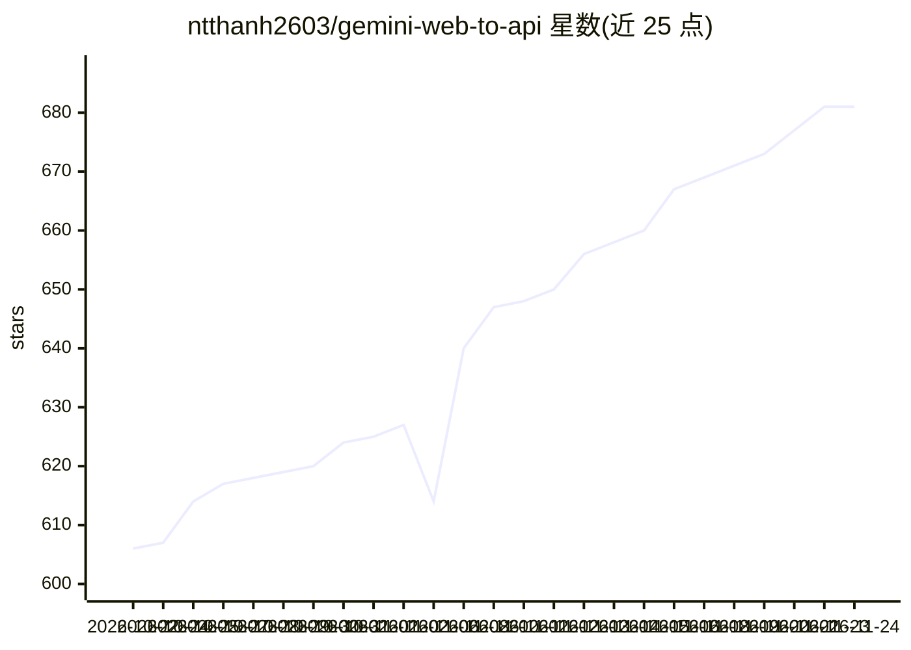

# ntthanh2603/gemini-web-to-api

⭐ 681 · Go · MIT · 推送 2026-11-17 · [GitHub](https://github.com/ntthanh2603/gemini-web-to-api) · 个人维护

**把 Gemini 网页版反向成 OpenAI/Claude/Gemini 兼容的本地 API 服务**

用 Go 与 Fiber 编写的本地 API 服务器，通过用户浏览器 Cookie 连接 Gemini Web 界面，无需 API key，暴露 OpenAI、Claude、Gemini 三种协议兼容的端点，供现有 SDK 直接接入。功能覆盖文本对话、图像生成与输入、视频与音乐生成、Canvas 文件读取，并自动轮换 Cookie 维持会话、估算 token 用量、清理引用标记。仅限研究与教育用途，声明与 Google 无关联且可能违反其服务条款。

## 筛选速览

| 维度 | 判定 | 备注 |
|---|---|---|
| AI 角色 | `ai-ecosystem` | LLM/agent 周边工具 |
| 许可风险 | `permissive` | MIT |
| 部署形态 | `self-host` | docker 或自建部署 |
| 模型依赖 | — | README 未给出锁定关系 |
| 硬件要求 | — | 无带数字的原话,不猜 |
| 安装摩擦 | `low` | 无编译、无系统依赖或容器化 |
| 成熟度 | — | 结构信号不足 |

## 能力要点

- 一个服务器暴露 OpenAI/Claude/Gemini 三种兼容 API 协议
- 基于浏览器 Cookie 认证，自动轮换 Cookie 维持会话
- 支持图像/视频/音乐生成与 Canvas 内容访问
- Docker Compose 部署、Scalar 交互文档与健康检查

## 适用场景

- 在没有 API key 的情况下本地调用 Gemini 模型
- 用现有 OpenAI/Claude SDK 本地测试与 Gemini 的集成
- 构建依赖 Gemini 最新模型的应用

## 场景标签

`图像生成` `模型网关` · 领域:Agent 开发

## 证据(README 行号)

> L16:  Transforms Google Gemini web interface into a standardized REST API.
> L34: - ✅ Exposes OpenAI / Claude / Gemini-compatible API endpoints
> L137: - 🌉 **Universal AI Bridge**: One server, three protocols (OpenAI, Claude, Gemini)

## 星数曲线

2026-10-22 606 → 2026-11-24 681（+75）

---
*卡片 v1 · prompt 1.4 · 生成 2026-11-24 · 置信度 mid · 依据 README sha `d9296ffee509` · [字段定义](../../DATASET.md)*
