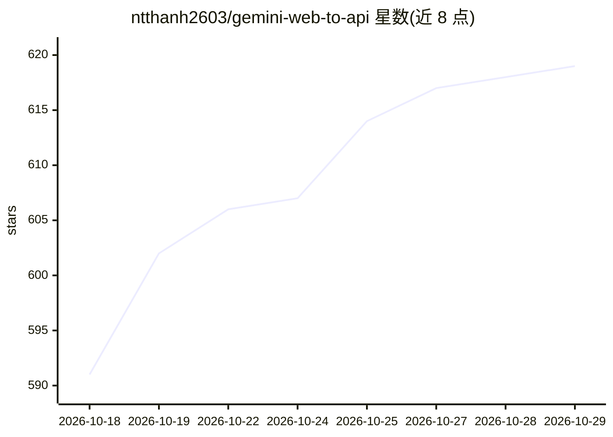

# ntthanh2603/gemini-web-to-api

⭐ 619 · Go · MIT · 推送 2026-10-28 · [GitHub](https://github.com/ntthanh2603/gemini-web-to-api) · 个人维护

**将 Gemini 网页版逆向封装为 OpenAI/Claude/Gemini 兼容 API 的本地网关**

基于 Go/Fiber 的本地 API 服务器：用户从浏览器复制 Gemini 网页的 Cookie 请求头注入服务，服务器据此连接 Gemini 网页接口，并对外暴露 OpenAI、Claude、Gemini 三套兼容端点，无需官方 API key。自动轮换会话 Cookie 维持在线，模型列表从账号的 Gemini 网页注册表动态发现。另支持图像输入、文生图、文生视频、Canvas 与音乐生成。README 声明仅供研究与教育用途、可能不合规 Google ToS，不可商用。提供 Docker 镜像与源码构建两种部署方式。

## 筛选速览

| 维度 | 判定 | 备注 |
|---|---|---|
| AI 角色 | `ai-ecosystem` | LLM/agent 周边工具 |
| 许可风险 | `permissive` | MIT |
| 部署形态 | `self-host` | docker 或自建部署 |
| 模型依赖 | locked-api |  |
| 硬件要求 | — | 无带数字的原话,不猜 |
| 安装摩擦 | `low` | 无编译、无系统依赖或容器化 |
| 成熟度 | — | 结构信号不足 |

## 能力要点

- 一个服务同时暴露 OpenAI / Claude / Gemini 三种兼容协议端点
- Cookie 认证 + 自动轮换会话，无需 API key
- 模型列表从 Gemini 网页注册表动态发现，新模型无需改代码
- 支持图像输入、文生图、文生视频（MP4）、Canvas 与音乐生成

## 适用场景

- 没有 API key 时在本地测试 Gemini 模型集成
- 让现有 OpenAI/Claude SDK 应用直接改用 Gemini 后端
- 在代码中调用 Gemini 网页的生图、生视频与音乐工具

## 场景标签

`模型网关` `图像生成` `视频生成` · 领域:Agent 开发

## 证据(README 行号)

> L16:  Transforms Google Gemini web interface into a standardized REST API.
> L31: **Solution**: Creates a local API server that:
> L34: - ✅ Exposes OpenAI / Claude / Gemini-compatible API endpoints

## 星数曲线

2026-10-18 591 → 2026-10-29 619（+28）

---
*卡片 v1 · prompt 1.4 · 生成 2026-10-21 · 置信度 mid · 依据 README sha `c0222257f609` · [字段定义](../../DATASET.md)*
