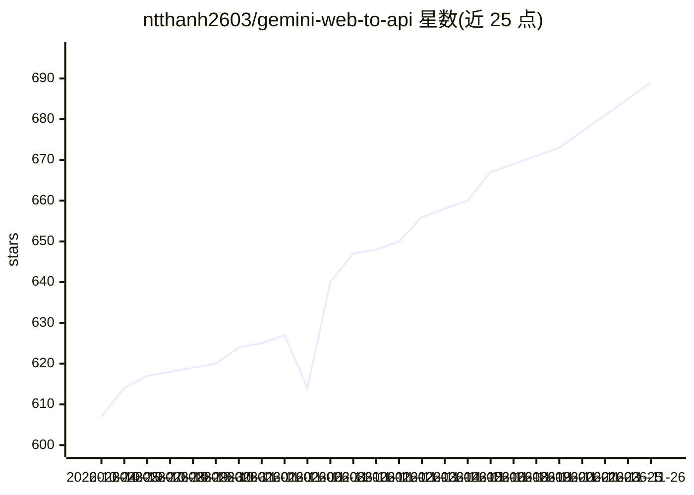

# ntthanh2603/gemini-web-to-api

⭐ 689 · Go · MIT · 推送 2026-11-24 · [GitHub](https://github.com/ntthanh2603/gemini-web-to-api) · 个人维护

**把 Gemini 网页版转为 OpenAI/Claude/Gemini 兼容 API 的本地服务器**

用 Go/Fiber 编写的本地 API 服务器：读取用户浏览器中的 Gemini 网页 Cookie，连接 Gemini Web 接口，对外暴露 OpenAI、Claude、Gemini 三种兼容的 REST 端点，可与现有 SDK 直接配合使用；自动轮换 Cookie 维持会话，支持图像/视频/音乐生成、Canvas 模型、JSON 响应与 token 用量估算（非计费级）。安装方式为 Docker 运行或源码构建（Go 1.21+）。README 声明仅供研究与教育用途，禁止商业使用，且未与 Google 关联，可能违反其服务条款。

## 筛选速览

| 维度 | 判定 | 备注 |
|---|---|---|
| AI 角色 | `ai-ecosystem` | LLM/agent 周边工具 |
| 许可风险 | `permissive` | MIT |
| 部署形态 | `self-host` | docker 或自建部署 |
| 模型依赖 | — | README 未给出锁定关系 |
| 硬件要求 | — | 无带数字的原话,不猜 |
| 安装摩擦 | `low` | 无编译、无系统依赖或容器化 |
| 成熟度 | — | 结构信号不足 |

## 能力要点

- 单一服务器暴露 OpenAI/Claude/Gemini 三种兼容 API 端点
- 自动轮换 Cookie 与会话管理，无需 API key
- 支持图像生成、图像输入、文生视频、音乐生成与 Canvas 模型
- 支持 Docker Compose、Scalar UI、健康检查与速率限制配置

## 适用场景

- 本地测试基于 Gemini 模型的应用集成
- 没有 API key 时通过浏览器 Cookie 使用 Gemini
- 用 OpenAI/Claude/Gemini SDK 调用 Gemini 最新模型

## 场景标签

`模型网关` · 领域:Agent 开发

## 证据(README 行号)

> L16:  Transforms Google Gemini web interface into a standardized REST API.
> L34: - ✅ Exposes OpenAI / Claude / Gemini-compatible API endpoints
> L137: - 🌉 **Universal AI Bridge**: One server, three protocols (OpenAI, Claude, Gemini)

## 星数曲线

2026-10-24 607 → 2026-11-26 689（+82）

---
*卡片 v1 · prompt 1.4 · 生成 2026-11-25 · 置信度 mid · 依据 README sha `404f78cc0404` · [字段定义](../../DATASET.md)*
