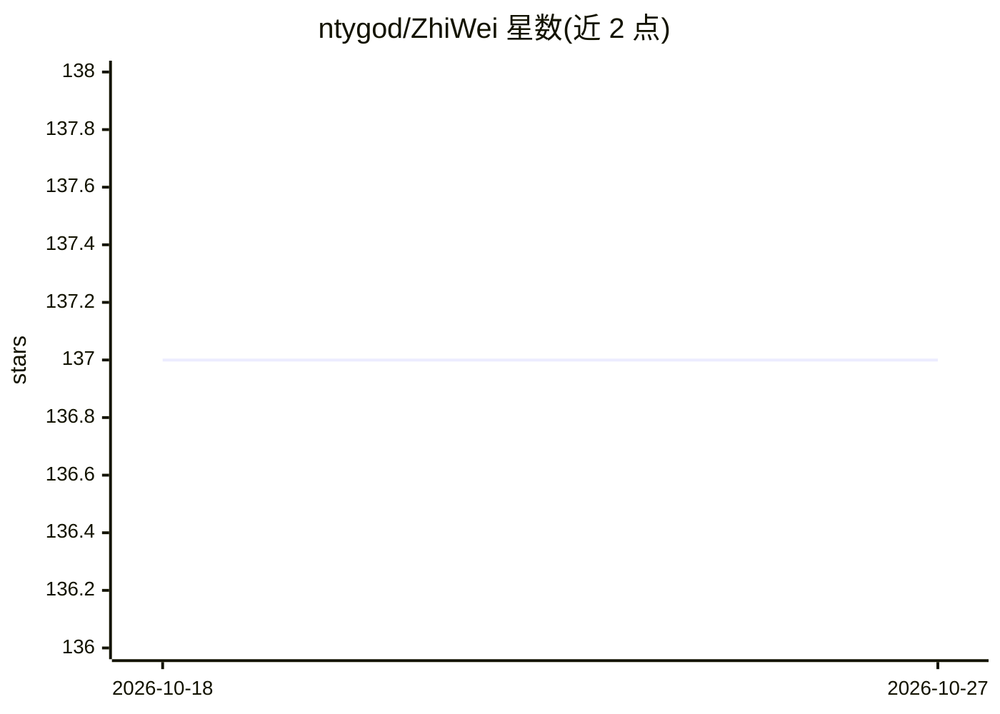

# ntygod/ZhiWei

⭐ 137 · Java · MIT · 推送 2026-08-11 · [GitHub](https://github.com/ntygod/ZhiWei) · 个人维护 · 中文 README

**本地优先的自托管个人 AI Agent 助手，带记忆与自主任务**

面向个人用户的自托管 AI Agent 系统：提供四层认知记忆（工作/情景/语义/程序记忆）、ReAct 循环驱动的自主任务执行（33 个内置技能）、YAML 工作流引擎、多 Agent 协作与插件市场。多 LLM 智能路由支持 DeepSeek/OpenAI/Anthropic/Ollama 等服务商，需自备 API Key 或本地模型。所有数据存于本地 SQLite（~/.zhiwei/），单用户设计，不支持集群。桌面客户端内嵌 JRE，亦提供 Docker Compose 与源码构建方式；Web UI 与飞书/钉钉/企微/QQ 渠道接入。

## 筛选速览

| 维度 | 判定 | 备注 |
|---|---|---|
| AI 角色 | `ai-native` | 本体是模型或模型工具 |
| 许可风险 | `permissive` | MIT |
| 部署形态 | `desktop` | 安装包/桌面程序 |
| 模型依赖 | local-ok | 支持本地模型 |
| 硬件要求 | — | 无带数字的原话,不猜 |
| 安装摩擦 | `low` | 无编译、无系统依赖或容器化 |
| 成熟度 | — | 结构信号不足 |

## 能力要点

- 四层认知记忆与自动巩固（向量+FTS5+时序混合检索）
- ReAct Agent 引擎，33 个内置技能，支持挂起恢复与技能自扩展
- 多 LLM 四路智能路由（生成/向量/精排/多模态）+ 熔断故障转移
- 本地 SQLite 存储、工具调用分级授权与代码沙箱

## 适用场景

- 个人搭建本地运行、数据不出本机的 AI 助手
- 让 Agent 自动执行定时/事件触发的任务工作流
- 通过飞书/钉钉等 IM 与个人 Agent 对话
- 用 Ollama 本地模型实现零 API 费用的私人助手

## 场景标签

`AI 助手` `Agent 记忆` `多智能体` `工作流自动化` · 领域:Agent 开发

## 证据(README 行号)

> L10: ZhiWei 是一个自托管的 AI Agent 系统。它不只是聊天机器人——拥有四层认知记忆、自主任务执行、工作流引擎和插件市场。所有数据存储在本地，隐私完全掌控。
> L294: ZhiWei（知微）是一个本地运行的 AI Agent 助手，具备自主任务执行能力，可以帮助你管理知识、提供自动化工作流能力。

## 星数曲线

2026-10-18 137 → 2026-10-27 137（+0）

---
*卡片 v1 · prompt 1.4 · 生成 2026-10-22 · 置信度 mid · 依据 README sha `4d9529f79dd6` · [字段定义](../../DATASET.md)*
