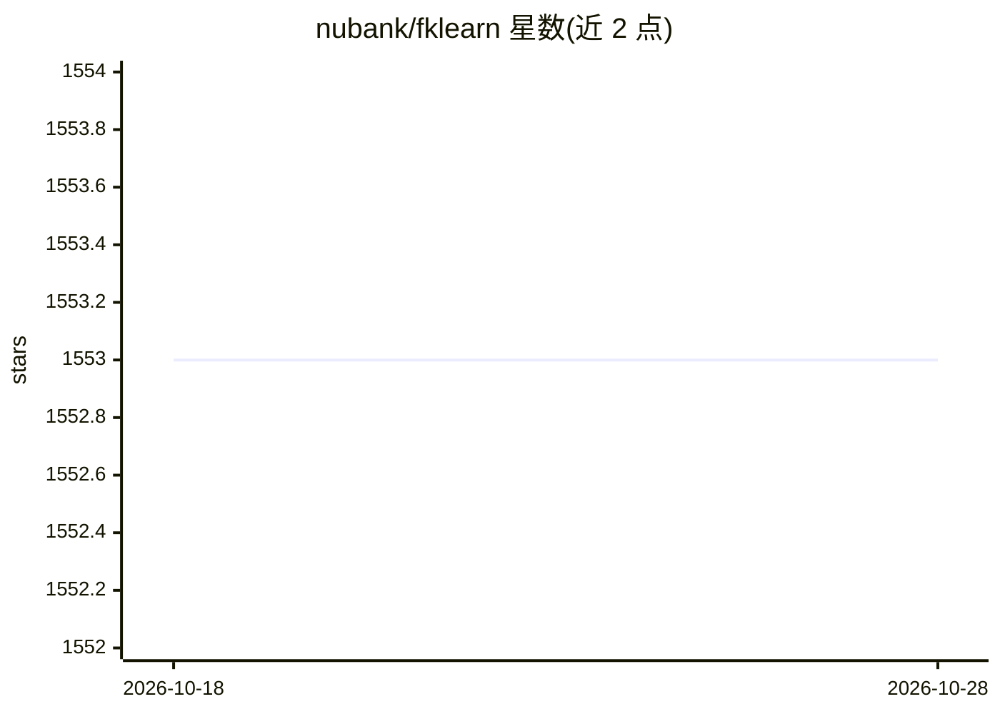

# nubank/fklearn

⭐ 1,553 · Jupyter Notebook · Apache-2.0 · 推送 2026-09-24 · [GitHub](https://github.com/nubank/fklearn) · 组织维护

**函数式机器学习 Python 库，供构建可复现、生产就绪的模型**

Nubank 开源的函数式机器学习库，名称致敬 scikit-learn。以函数式编程原则组织机器学习流程，强调验证贴近真实场景、生产模型与验证模型一致、模型可直接上生产，以及结果易复现与深入分析。核心安装通过 pip，另提供 LightGBM/XGBoost/CatBoost 可选模型后端；开发流程基于 uv 管理依赖。README 明确声明该库已弃用（deprecated），支持有限，无专门团队维护，属章节式所有（chapter-owned）。采用 Apache 2.0 许可。

## 筛选速览

| 维度 | 判定 | 备注 |
|---|---|---|
| AI 角色 | `ai-native` | 本体是模型或模型工具 |
| 许可风险 | `permissive` | Apache-2.0 |
| 部署形态 | `library` | 以包/库形式分发 |
| 模型依赖 | — | README 未给出锁定关系 |
| 硬件要求 | — | 无带数字的原话,不猜 |
| 安装摩擦 | `low` | 无编译、无系统依赖或容器化 |
| 成熟度 | — | 结构信号不足 |

## 能力要点

- 函数式编程原则组织机器学习流程
- 可选 LightGBM/XGBoost/CatBoost 模型后端
- 强调生产模型与验证模型一致的工程原则
- 开发流程基于 uv 依赖管理

## 适用场景

- 构建强调生产-验证一致性的机器学习流程
- 需要可复现模型训练与分析的数据科学项目

## 场景标签

`模型训练` · 领域:训练与推理

## 证据(README 行号)

> L12: **fklearn** uses functional programming principles to make it easier to solve real problems with Machine Learning.
> L18: 1. Validation should reflect real-life situations.
> L20: 3. Models should be production-ready with few extra steps.

## 星数曲线

2026-10-18 1,553 → 2026-10-28 1,553（+0）

---
*卡片 v1 · prompt 1.4 · 生成 2026-10-21 · 置信度 high · 依据 README sha `16cdf0dccb39` · [字段定义](../../DATASET.md)*
