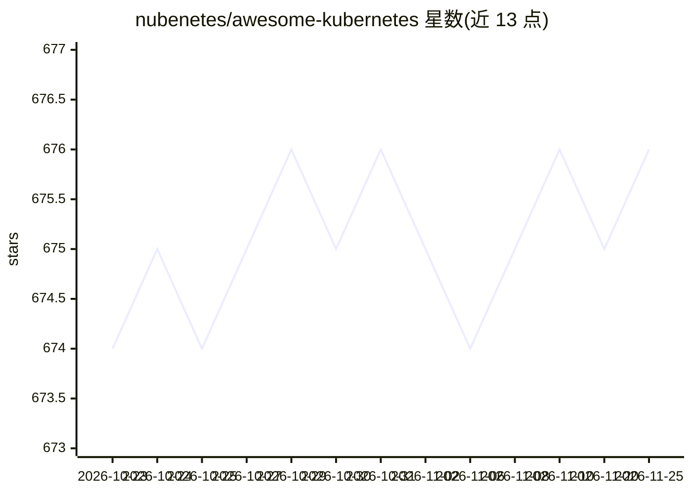

# nubenetes/awesome-kubernetes

⭐ 676 · HTML · Apache-2.0 · 推送 2026-11-23 · [GitHub](https://github.com/nubenetes/awesome-kubernetes) · [官网](https://nubenetes.com) · 个人维护

**为工程师策展的 Kubernetes 与云原生/Agentic AI 资源档案**

自 2018 年起持续收集的 Kubernetes 与云原生资源策展仓库，收录 20,000+ 条链接、185 个专题页面。结构分为 V1 详尽档案（docs/，162 个分类）与 V2 AI 精选门户（v2-docs/，按 Impact 评分去重）双版本，并附视频中心。自述采用 Python 3.11+ 编写的 agentic 引擎，基于 Google Gemini 与 MCP 通过 GitHub Actions 定时自动评估、评分、分类与巡检链接健康度。无面向终端用户的 AI 产出功能，主体是知识清单本身。

## 筛选速览

| 维度 | 判定 | 备注 |
|---|---|---|
| AI 角色 | `ai-knowledge` | 知识聚合/清单类 |
| 许可风险 | `permissive` | Apache-2.0 |
| 部署形态 | `None` |  |
| 模型依赖 | — | README 未给出锁定关系 |
| 硬件要求 | — | 无带数字的原话,不猜 |
| 安装摩擦 | `low` | 无编译、无系统依赖或容器化 |
| 成熟度 | `idea` | |

## 能力要点

- 收录 20,895+ 技术资源链接、185 个专题 Markdown 页面
- V1 档案/V2 AI 精选门户双版本结构
- 自述 agentic 策展引擎：Gemini 评分分类 + GitHub Actions 自动巡检
- 附 MCP/GitOps/云原生主题的教育视频短片系列

## 适用场景

- 查找 Kubernetes 与云原生领域的学习参考资料
- 调研云原生工具生态的成熟度与类别分布
- 系统了解 GitOps、FinOps、MCP 等专题的链接集合

## 场景标签

`精选清单` · 领域:学习与行业

## 证据(README 行号)

> L11: **Nubenetes** is a high-density, curated archive of the Kubernetes, Cloud Native, and Agentic AI ecosystem. Since i
> L32: |**Comprehensive Research & Deep Dives**|**V1: Exhaustive Archive**|`docs/`|18,600+ links across 162 specialized ca
> L207: |**Discovery**|Twikit and Playwright|Autonomous scraping and account rotation.|

## 星数曲线

2026-10-23 674 → 2026-11-25 676（+2）

---
*卡片 v1 · prompt 1.4 · 生成 2026-11-24 · 置信度 high · 依据 README sha `037ee0766636` · [字段定义](../../DATASET.md)*
