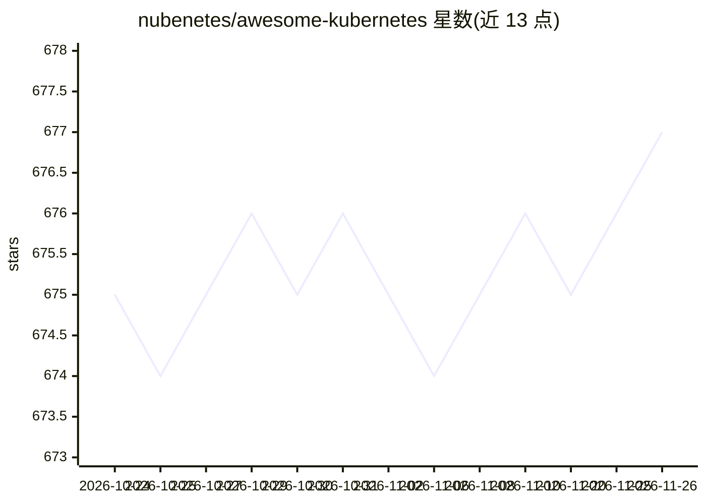

# nubenetes/awesome-kubernetes

⭐ 677 · HTML · Apache-2.0 · 推送 2026-11-25 · [GitHub](https://github.com/nubenetes/awesome-kubernetes) · [官网](https://nubenetes.com) · 个人维护

**为工程师提供 Kubernetes/云原生与 Agentic AI 资源的策展档案**

始于 2018 年的云原生资源策展仓库，收录 20,000+ 条链接，覆盖 Kubernetes、DevOps、DevSecOps、公有云与 AI Agent/MCP 等类别。采用双版本结构：V1 详尽档案（docs/，186 类）与 V2 AI 策展门户（v2-docs/，按 Impact 评分去重）。自述自 2026 年起采用基于 Google Gemini 与 MCP 的自动化策展引擎，由 GitHub Actions 调度执行资源评估、打分、链接健康检查与许可监控，并以 MkDocs Material 生成静态站点。仓库内容以链接集合为主，本身不提供可运行的服务。

## 筛选速览

| 维度 | 判定 | 备注 |
|---|---|---|
| AI 角色 | `ai-knowledge` | 知识聚合/清单类 |
| 许可风险 | `permissive` | Apache-2.0 |
| 部署形态 | `None` |  |
| 模型依赖 | — | README 未给出锁定关系 |
| 硬件要求 | — | 无带数字的原话,不猜 |
| 安装摩擦 | `low` | 无编译、无系统依赖或容器化 |
| 成熟度 | `idea` | |

## 能力要点

- 收录 20,899+ 条技术资源链接，组织为 185 个专题 MD 页面
- 基于 GitHub Actions 调度的自动化策展流水线（Python 3.11+）
- AI 引擎执行资源评分、语义聚类与链接健康监控
- 双版本结构：V1 详尽档案与 V2 策展门户

## 适用场景

- 查找 Kubernetes 与云原生领域的参考资料
- 调研 DevSecOps、FinOps 等主题的工具与博客
- 跟踪 AI Agent 与 MCP 生态的相关资源

## 场景标签

`精选清单` · 领域:学习与行业

## 证据(README 行号)

> L11: **Nubenetes** is a high-density, curated archive of the Kubernetes, Cloud Native, and Agentic AI ecosystem. Since i
> L32: |**Comprehensive Research & Deep Dives**|**V1: Exhaustive Archive**|`docs/`|18,600+ links across 162 specialized ca
> L35: |**Automated Knowledge Pipeline**|**Agentic Source Code**|`src/`|Python 3.11+ agentic engine leveraging Google Gemi

## 星数曲线

2026-10-24 675 → 2026-11-26 677（+2）

---
*卡片 v1 · prompt 1.4 · 生成 2026-11-26 · 置信度 high · 依据 README sha `61679c35fecc` · [字段定义](../../DATASET.md)*
