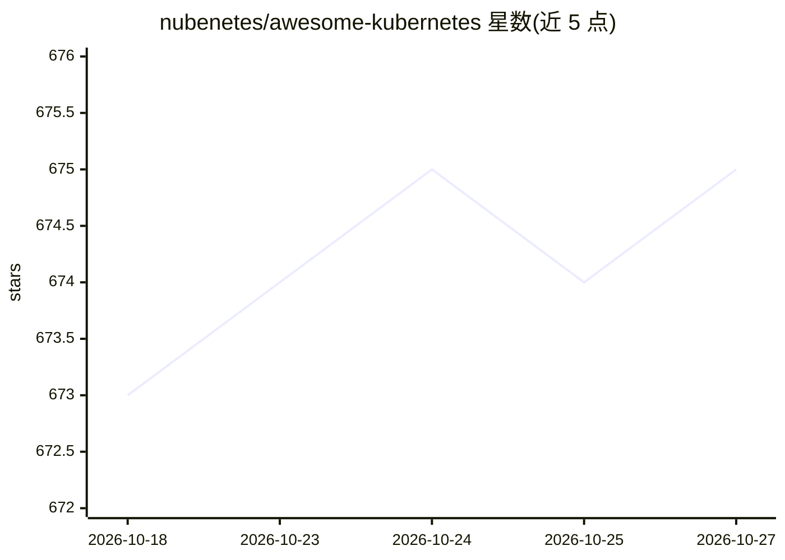

# nubenetes/awesome-kubernetes

⭐ 675 · HTML · Apache-2.0 · 推送 2026-10-26 · [GitHub](https://github.com/nubenetes/awesome-kubernetes) · [官网](https://nubenetes.com) · 个人维护

**Kubernetes/云原生/Agentic AI 技术资源策展档案（18,600+ 链接）**

始于 2018 年的云原生技术资源策展仓库，现已演化为双版本知识引擎：V1 穷尽式档案含 18,600+ 链接、162 个专题 Markdown 页面；V2 Agentic Elite Portal 由 AI 引擎（Google Gemini + MCP）评分、去重并标注成熟度徽章。策展流水线含健康监控、许可合规监控、语义聚类与视频学习路径，通过 GitHub Actions 编排运行。面向需要检索与核验云原生技术资料的工程师。

## 筛选速览

| 维度 | 判定 | 备注 |
|---|---|---|
| AI 角色 | `ai-knowledge` | 知识聚合/清单类 |
| 许可风险 | `permissive` | Apache-2.0 |
| 部署形态 | `None` |  |
| 模型依赖 | — | README 未给出锁定关系 |
| 硬件要求 | — | 无带数字的原话,不猜 |
| 安装摩擦 | `low` | 无编译、无系统依赖或容器化 |
| 成熟度 | — | 结构信号不足 |

## 能力要点

- V1 穷尽档案 18,600+ 链接覆盖 162 个专题类别
- V2 门户由 Google Gemini+MCP 的 agentic 引擎自动评分与去重
- 自动健康检查、许可合规监控与失效链接救援机制
- 配套 AI 生成的 YouTube 技术短视频系列（多语言字幕）

## 适用场景

- 系统检索 Kubernetes 与云原生生态工具和参考资料
- 按类别浏览 Terraform、监控、DevSecOps 等专题资源
- 通过 V2 高密度入口做工具选型的快速筛选

## 场景标签

`精选清单` · 领域:学习与行业

## 证据(README 行号)

> L11: **Nubenetes** is a high-density, curated archive of the Kubernetes, Cloud Native, and Agentic AI ecosystem. Since i
> L32: |**Comprehensive Research & Deep Dives**|**V1: Exhaustive Archive**|`docs/`|18,600+ links across 162 specialized ca
> L104: |**Total Technical Resources (Links)**|**18662+**|

## 星数曲线

2026-10-18 673 → 2026-10-27 675（+2）

---
*卡片 v1 · prompt 1.4 · 生成 2026-10-21 · 置信度 high · 依据 README sha `bf71ec8b6919` · [字段定义](../../DATASET.md)*
