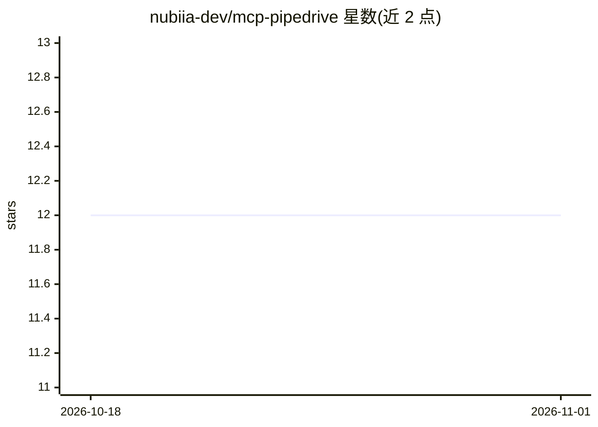

# nubiia-dev/mcp-pipedrive

⭐ 12 · TypeScript · MIT · 推送 2026-10-22 · [GitHub](https://github.com/nubiia-dev/mcp-pipedrive) · 组织维护

**面向 Claude 的 Pipedrive CRM MCP 服务器：307 个工具覆盖全 API**

由 Nubiia 开发的 Model Context Protocol 服务器，使 Claude 等 AI 助手通过自然语言操作 Pipedrive CRM：307 个工具分布在 29 个类别（交易、联系人、组织、项目、管线等），覆盖 Pipedrive REST API v1 与 v2。内置速率限制（10 请求/秒、突发容量 100）、多级缓存（5-15 分钟 TTL）、指数退避重试与请求指标追踪；支持只读模式与工具类别过滤，提供 3 个 MCP 资源与 5 个引导工作流。通过 npm 全局安装或 npx 免安装运行，需配置 Pipedrive API token。

## 筛选速览

| 维度 | 判定 | 备注 |
|---|---|---|
| AI 角色 | `ai-ecosystem` | LLM/agent 周边工具 |
| 许可风险 | `permissive` | MIT |
| 部署形态 | `library` | 以包/库形式分发 |
| 模型依赖 | locked-api |  |
| 硬件要求 | — | 无带数字的原话,不猜 |
| 安装摩擦 | `low` | 无编译、无系统依赖或容器化 |
| 成熟度 | — | 结构信号不足 |

## 能力要点

- 307 个工具覆盖 Pipedrive REST API v1+v2，分 29 个类别
- 速率限制/多级缓存/重试/指标等生产级机制
- 只读模式与工具类别过滤配置
- 自定义字段名自动解析为 Pipedrive hash key

## 适用场景

- 让 Claude 直接创建和跟进 CRM 交易、联系人与活动
- 用自然语言生成管线报告与周度销售回顾
- 销售团队通过对话完成线索资格审查与流程自动化

## 场景标签

`工作流自动化` · 领域:效率与自动化

## 证据(README 行号)

> L10: A production-ready Model Context Protocol server that provides Claude with comprehensive access to the Pipedrive CR
> L84: 2. Have Claude Desktop installed

## 星数曲线

2026-10-18 12 → 2026-11-01 12（+0）

---
*卡片 v1 · prompt 1.4 · 生成 2026-11-01 · 置信度 high · 依据 README sha `d8f6cdc68ff7` · [字段定义](../../DATASET.md)*
