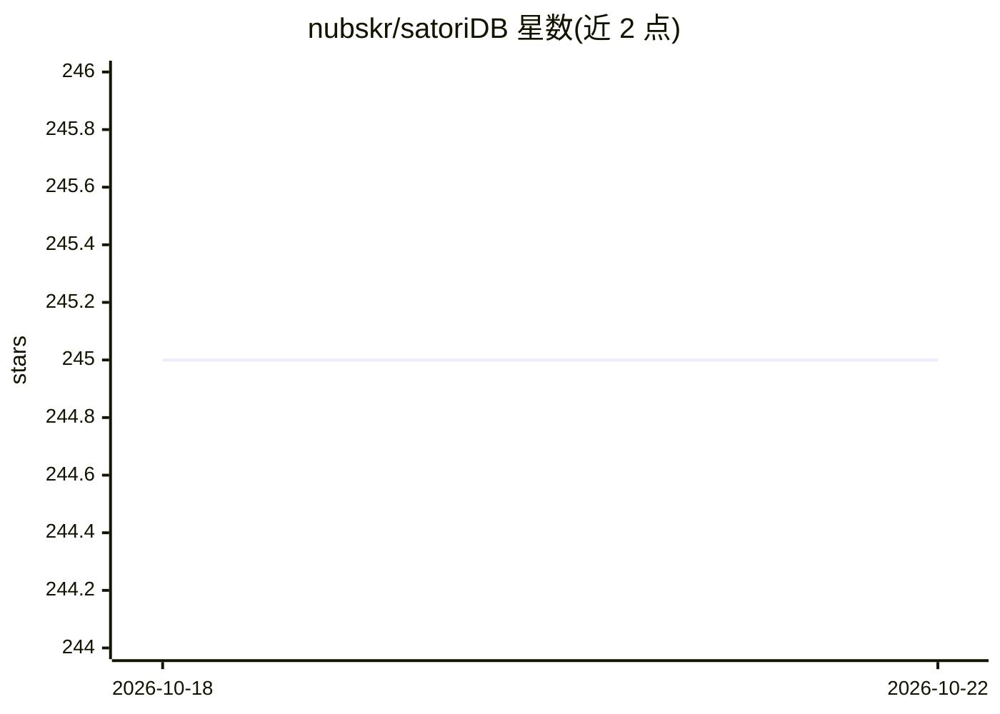

# nubskr/satoriDB

⭐ 245 · Rust · MIT · 推送 2026-01-24 · [GitHub](https://github.com/nubskr/satoriDB) · 个人维护

**Rust 嵌入式向量数据库：处理超内存的十亿级 ANN 检索**

以 cargo 依赖形式嵌入进程内的向量数据库，面向大于内存的十亿级 ANN 检索负载。采用两层架构：RAM 中基于量化 HNSW 的路由索引定位相关桶（bucket），由 CPU 绑定的 Glommio worker 经 io_uring 并行扫描磁盘上的冷数据。k-means 聚类组织向量，后台自动分裂超限桶以稳定延迟。提供同步/异步 Rust API、可配置 fsync 持久化策略与构建参数。仅支持 Linux（需 io_uring，内核 5.8+）。

## 筛选速览

| 维度 | 判定 | 备注 |
|---|---|---|
| AI 角色 | `ai-ecosystem` | LLM/agent 周边工具 |
| 许可风险 | `permissive` | MIT |
| 部署形态 | `library` | 以包/库形式分发 |
| 模型依赖 | — | README 未给出锁定关系 |
| 硬件要求 | — | 无带数字的原话,不猜 |
| 安装摩擦 | `medium` | 含编译或系统依赖之一 |
| 成熟度 | — | 结构信号不足 |

## 能力要点

- 两层检索：RAM 量化 HNSW 路由 + 磁盘桶并行扫描
- SIMD（AVX2/AVX-512）加速距离计算与量化
- 桶自动分裂的重平衡机制稳定查询延迟
- BigANN 基准在 1B 向量下报告 95%+ 召回

## 适用场景

- 在 Rust 应用中嵌入十亿级向量的相似度检索
- 内存装不下全量向量时的大规模 ANN 查询
- 需要进程内运行、无外部服务依赖的向量存储

## 场景标签

 · 领域:数据库/向量检索基础设施

## 证据(README 行号)

> L11: SatoriDB is an embedded vector database built for bigger than memory workloads for ANN search and handles billion s
> L37: - **Embedded**: runs entirely in-process, no external services

## 星数曲线

2026-10-18 245 → 2026-10-22 245（+0）

---
*卡片 v1 · prompt 1.4 · 生成 2026-10-22 · 置信度 high · 依据 README sha `60d1e6f701da` · [字段定义](../../DATASET.md)*
