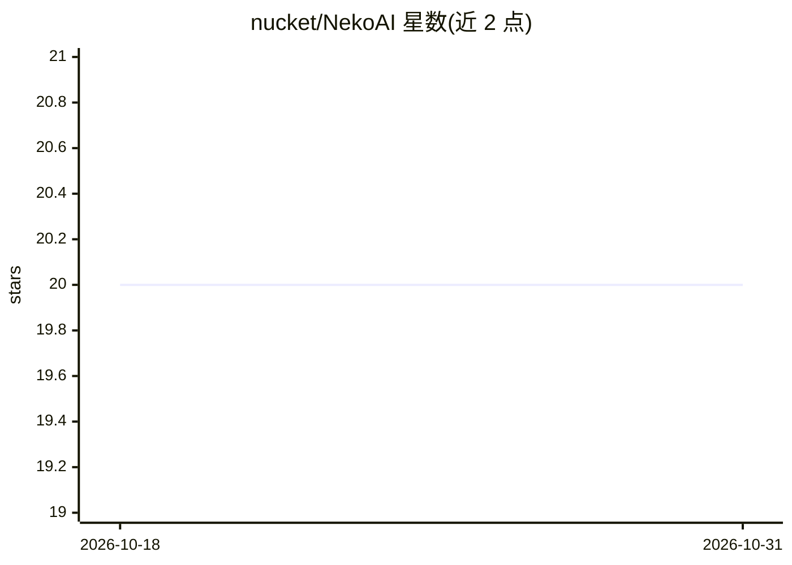

# nucket/NekoAI

⭐ 20 · TypeScript · MIT · 推送 2026-10-30 · [GitHub](https://github.com/nucket/NekoAI) · [官网](https://nekoai.dev/) · 个人维护

**带 AI 聊天能力的开源桌面宠物（经典 Neko 复刻）**

基于 Tauri + Rust/React/TypeScript 构建的跨平台桌面宠物：像素动画宠物在桌面上漫游、跟随鼠标、通过气泡对话。AI 功能包括多供应商聊天（Anthropic、OpenAI、Gemini、NVIDIA NIM、本地 Ollama，均由 Rust 端统一调用）、持久化用户记忆（SQLite 存储，模式匹配提取事实）、随时间/空闲/活动变化的情绪引擎影响回答语气。API key 存放系统凭据管理器，无后端服务器，数据留在本机。提供安装包下载与源码构建两种方式；Wayland 下跟随鼠标需加入 input 组，否则自动退回漫游模式。

## 筛选速览

| 维度 | 判定 | 备注 |
|---|---|---|
| AI 角色 | `ai-enhanced` | 去掉 AI 部分产品仍成立 |
| 许可风险 | `permissive` | MIT |
| 部署形态 | `desktop` | 安装包/桌面程序 |
| 模型依赖 | local-ok | 支持本地模型 |
| 硬件要求 | — | 无带数字的原话,不猜 |
| 安装摩擦 | `low` | 无编译、无系统依赖或容器化 |
| 成熟度 | — | 结构信号不足 |

## 能力要点

- 多供应商 AI 聊天：Claude/OpenAI/Gemini/NVIDIA NIM/Ollama，由 Rust 端统一 ai_chat 命令调用
- SQLite 持久化记忆：自动从对话提取用户事实，附最近 20 条对话作上下文
- 情绪引擎：按时间/空闲/应用类型更新能量，影响动画与回答语气
- 零配置引导：首次启动自动检测本地 Ollama 并完成配置

## 适用场景

- 在桌面上养一只能回答问题、帮忙解释代码的像素宠物
- 用本地 Ollama 实现完全离线私密的桌面 AI 伴侣
- 通过 pet.json 与自定义精灵创建个性化宠物

## 场景标签

`聊天机器人` · 领域:对话与助手

## 证据(README 行号)

> L26: NekoAI is an **open-source, AI-powered desktop pet** that lives on your screen. It wanders around your windows, rea
> L60: |🔌 Multi-provider AI (Claude, OpenAI, Gemini, NVIDIA NIM, Ollama local)|✅|

## 星数曲线

2026-10-18 20 → 2026-10-31 20（+0）

---
*卡片 v1 · prompt 1.4 · 生成 2026-10-28 · 置信度 high · 依据 README sha `b4dae7bc1670` · [字段定义](../../DATASET.md)*
