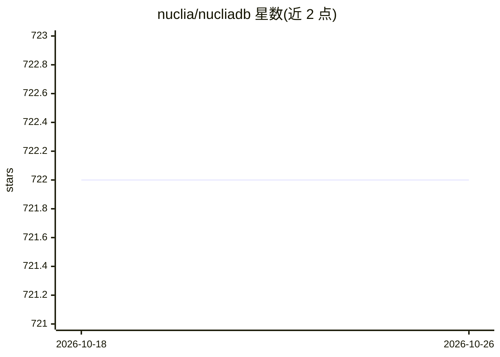

# nuclia/nucliadb

⭐ 722 · Python · NOASSERTION · 推送 2026-10-24 · [GitHub](https://github.com/nuclia/nucliadb) · [官网](https://docs.nuclia.dev/docs/management/nucliadb/intro) · 组织维护

**面向 RAG 的 AI 搜索数据库：存储并检索非结构化数据**

用 Rust 与 Python 编写的数据库，用于存储和检索非结构化数据，提供向量、全文与图索引的混合搜索，支持语义搜索与关键词搜索。存储层基于 PostgreSQL，支持 S3 兼容 API、GCS、Azure Blob Storage，提供多租户、分布式搜索与基于角色的安全系统。可结合 Nuclia 云服务（Understanding API/Learning API）完成数据抽取、富化与推理。采用 AGPLv3 许可，由 Nuclia 公司维护，另提供 nuclia.cloud 托管服务。

## 筛选速览

| 维度 | 判定 | 备注 |
|---|---|---|
| AI 角色 | `ai-ecosystem` | LLM/agent 周边工具 |
| 许可风险 | `none` | NOASSERTION |
| 部署形态 | `None` |  |
| 模型依赖 | — | README 未给出锁定关系 |
| 硬件要求 | — | 无带数字的原话,不猜 |
| 安装摩擦 | `low` | 无编译、无系统依赖或容器化 |
| 成熟度 | — | 结构信号不足 |

## 能力要点

- 向量、全文与图索引的混合搜索
- 存储层基于 PostgreSQL，Blob 支持 S3/GCS/Azure
- 多租户支持、分布式搜索、角色权限与代理认证校验
- 数据可导出为 HuggingFace datasets、PyTorch 等 NLP 流水线兼容格式

## 适用场景

- 为 RAG 应用存储并检索非结构化数据
- 在关键词匹配之外做基于向量的语义搜索
- 导出已索引数据供 NLP 训练流水线使用

## 场景标签

`语义搜索` `向量数据库` · 领域:知识与检索

## 证据(README 行号)

> L10:  The AI Search Database.
> L19: It is an out of the box hybrid search database, utilizing vector,
> L20: full text and graph indexes.

## 星数曲线

2026-10-18 722 → 2026-10-26 722（+0）

---
*卡片 v1 · prompt 1.4 · 生成 2026-10-21 · 置信度 high · 依据 README sha `c2adfe3e6c90` · [字段定义](../../DATASET.md)*
