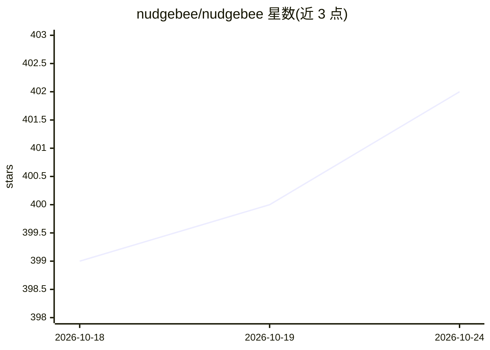

# nudgebee/nudgebee

⭐ 402 · Go · NOASSERTION · 推送 2026-10-24 · [GitHub](https://github.com/nudgebee/nudgebee) · [官网](https://nudgebee.com/) · 组织维护

**开源 SRE 副驾驶平台：跨 K8s 与多云的可观测、FinOps 与事件响应**

面向运维团队的 CloudOps 平台，接入 Kubernetes 集群与 AWS/Azure/GCP 账户，采集事件、指标、追踪与云厂商扫描，产出排序后的发现项：闲置资源与右size建议（FinOps）、可复用 runbook 自动化、双向工单同步（Jira/ServiceNow/PagerDuty/Zenduty）及 Slack/Teams ChatOps。AI 部分包括 LLM 驱动的事件triage（复现、根因、修复建议）与仪表盘 AI 助手，配合 rag-server 与按需代码分析容器。架构为 Go/Python/TypeScript 单仓库，含 llm-server、rag-server、Temporal 编排的 runbook-server。许可为 BSL 1.1；本地开发需 Docker/Podman、Go 1.26+、Node 25+，K8s 部署提供 Helm OCI chart（内嵌 Postgres/RabbitMQ/Redis/Qdrant/Temporal）。

## 筛选速览

| 维度 | 判定 | 备注 |
|---|---|---|
| AI 角色 | `ai-enhanced` | 去掉 AI 部分产品仍成立 |
| 许可风险 | `none` | NOASSERTION |
| 部署形态 | `self-host` | docker 或自建部署 |
| 模型依赖 | — | README 未给出锁定关系 |
| 硬件要求 | — | 无带数字的原话,不猜 |
| 安装摩擦 | `low` | 无编译、无系统依赖或容器化 |
| 成熟度 | — | 结构信号不足 |

## 能力要点

- K8s 与 AWS/Azure/GCP 信号采集并生成排序发现项
- FinOps：闲置资源发现与右size建议
- LLM 驱动的事件 triage（复现、根因、修复建议）与仪表盘 AI 助手
- Temporal 编排的 runbook 自动化 + Slack/Teams ChatOps

## 适用场景

- 统一查看 K8s 集群与多云账户的告警、成本与资源问题
- 让 AI 助手回答集群问题或发起调查
- 把常见修复固化为 runbook，从聊天/告警/定时触发

## 场景标签

`AI 助手` `RAG` · 领域:对话与助手

## 证据(README 行号)

> L13: Nudgebee is an open-source SRE copilot that watches your Kubernetes clusters and AWS / Azure / GCP accounts, turns 
> L17: - **LLM-powered triage** — agentic planners that reproduce, root-cause, and propose fixes for incidents.
> L193: 4. **Ask the AI assistant something** — bottom-right corner of the dashboard. It can answer questions about your c

## 星数曲线

2026-10-18 399 → 2026-10-24 402（+3）

---
*卡片 v1 · prompt 1.4 · 生成 2026-10-22 · 置信度 high · 依据 README sha `85a7c4a35b58` · [字段定义](../../DATASET.md)*
