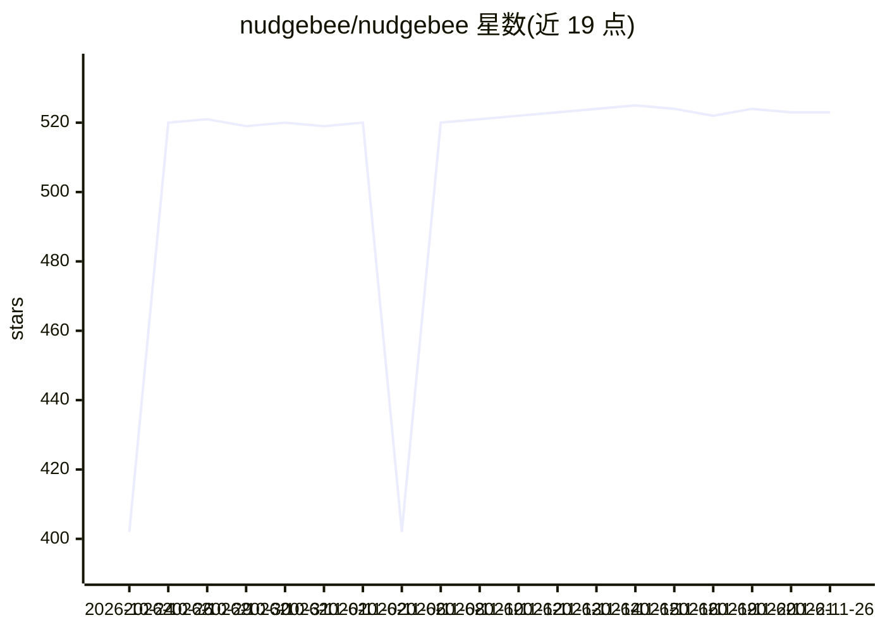

# nudgebee/nudgebee

⭐ 523 · Go · NOASSERTION · 推送 2026-11-25 · [GitHub](https://github.com/nudgebee/nudgebee) · [官网](https://nudgebee.com/) · 组织维护

**面向云/SRE/DevOps/FinOps 团队的自托管 agentic 运维平台**

自托管的 agentic 运维平台，把 AI agent 用于事件调查、云与 Kubernetes 资源浪费削减、数据库诊断和 runbook 自动化：Nubi 助手从日志、指标、追踪与实时集群给出带证据的根因；Kubernetes agent 集成 kubectl/Helm/Argo CD 工具，并支持 AWS/Azure/GCP 与多种数据库。提供人工审批门、审计日志、无使用遥测，可接入 Slack/Teams/Jira 等渠道。支持 Helm 部署到 Kubernetes 或从源码运行，可自选 LLM 提供商。

## 筛选速览

| 维度 | 判定 | 备注 |
|---|---|---|
| AI 角色 | `ai-native` | 本体是模型或模型工具 |
| 许可风险 | `none` | NOASSERTION |
| 部署形态 | `self-host` | docker 或自建部署 |
| 模型依赖 | — | README 未给出锁定关系 |
| 硬件要求 | — | 无带数字的原话,不猜 |
| 安装摩擦 | `low` | 无编译、无系统依赖或容器化 |
| 成熟度 | — | 结构信号不足 |

## 能力要点

- AI 助手 Nubi 对告警做分诊并给出带证据的根因分析
- Temporal 上的持久化 runbook，支持审批门触发
- Kubernetes/cloud/数据库多类 agent，含 eBPF 节点采集
- 自托管、无使用遥测、自带模型接入

## 适用场景

- 让 AI agent 调查生产环境的告警与故障
- 发现云和 Kubernetes 中未使用或超配的资源
- 把重复性修复固化为带审批的自动化 runbook

## 场景标签

`工作流自动化` · 领域:效率与自动化

## 证据(README 行号)

> L3: The open-source agentic ops platform for cloud, SRE, DevOps, support and FinOps teams: self-hosted, on your own mode
> L14: Nudgebee puts AI agents to work on your team's repeatable ops work, across incidents, cost, Kubernetes, cloud and d
> L16: - **Investigate incidents** — Nubi, the AI assistant, triages alerts and works to an evidence-backed root cause fro

## 星数曲线

2026-10-24 402 → 2026-11-26 523（+121）

---
*卡片 v1 · prompt 1.4 · 生成 2026-11-25 · 置信度 high · 依据 README sha `bf98a188281f` · [字段定义](../../DATASET.md)*
