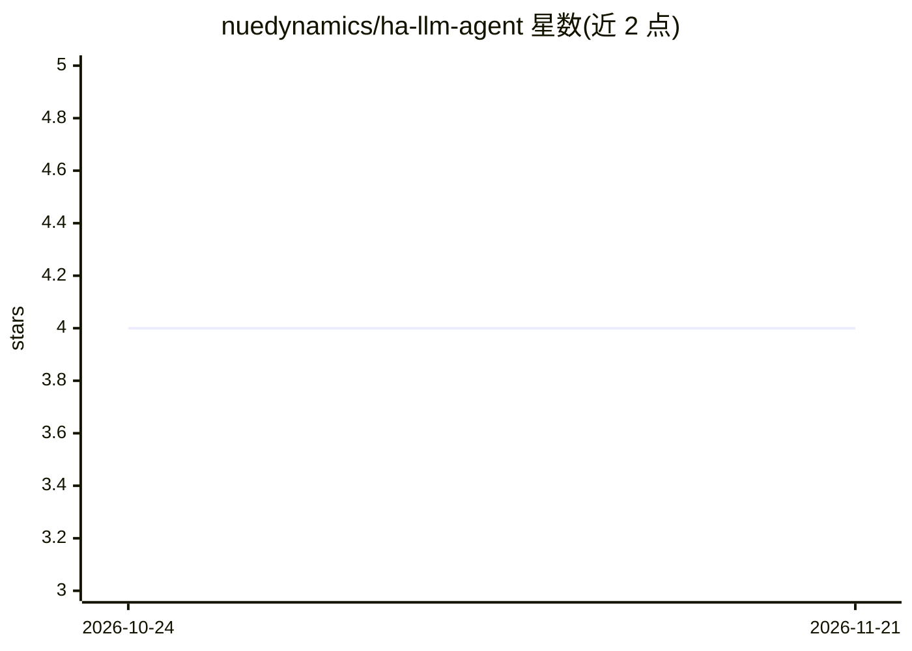

# nuedynamics/ha-llm-agent

⭐ 4 · Python · Apache-2.0 · 推送 2026-11-01 · [GitHub](https://github.com/nuedynamics/ha-llm-agent) · 组织维护

**Home Assistant 侧边栏聊天面板：AI 控制设备、生成自动化与仪表盘**

以 Home Assistant 自定义集成形式运行的 LLM 代理：在侧边栏提供聊天面板与 Assist 语音/文本对话代理，可控制实体、读取状态与历史统计、生成并写入自动化/脚本/场景/仪表盘、编辑 YAML、解释自动化失败原因并检索官方文档与论坛。自带审批机制（diff 预览、撤销、Reviewer 第二模型、只读模式、审批规则、每日花费上限），以管理员权限运行，README 要求先阅读 DISCLAIMER.md。无 add-on 与容器，无需安装 Python 包。

## 筛选速览

| 维度 | 判定 | 备注 |
|---|---|---|
| AI 角色 | `ai-enhanced` | 去掉 AI 部分产品仍成立 |
| 许可风险 | `permissive` | Apache-2.0 |
| 部署形态 | `desktop` | 安装包/桌面程序 |
| 模型依赖 | local-ok | 支持本地模型 |
| 硬件要求 | — | 无带数字的原话,不猜 |
| 安装摩擦 | `low` | 无编译、无系统依赖或容器化 |
| 成熟度 | — | 结构信号不足 |

## 能力要点

- 通过 llm_agent.ask 动作在自动化/脚本中调用 LLM，支持定时提示
- 多种审批模式：diff 审批卡、Undo、Reviewer 第二模型、只读模式、allow/ask/deny 规则
- 对网页内容、MCP 工具、家庭笔记读取后强制升级为人工审批
- 支持相机快照/照片图像理解（需具备视觉能力的模型）

## 适用场景

- 用自然语言让 AI 帮我写自动化、脚本和仪表盘
- 让 AI 查询家里设备状态并解释自动化为什么没触发
- 通过语音 Assist 用同一个模型控制已暴露的实体
- 在自动化流程里让 AI 定时汇总门窗和电池状态

## 场景标签

`聊天机器人` · 领域:对话与助手

## 证据(README 行号)

> L10: scenes, dashboards and helpers. Bring your own model: Anthropic, OpenAI, OpenRouter, Google Gemini, your ChatGPT
> L13: It's lightweight: an ordinary integration that runs inside Home Assistant. There's no
> L95: It also adds an **Assist conversation agent** for each provider, so you can use the same

## 星数曲线

2026-10-24 4 → 2026-11-21 4（+0）

---
*卡片 v1 · prompt 1.4 · 生成 2026-11-21 · 置信度 mid · 依据 README sha `dbd420caffb9` · [字段定义](../../DATASET.md)*
