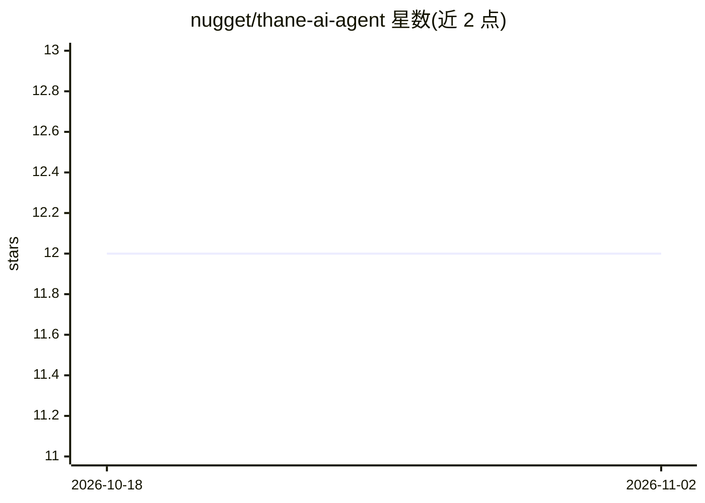

# nugget/thane-ai-agent

⭐ 12 · Go · Apache-2.0 · 推送 2026-10-29 · [GitHub](https://github.com/nugget/thane-ai-agent) · 个人维护

**Home Assistant 的自主 AI 代理：感知家居数据并自主执行**

用 Go 编写的单二进制家居 AI 代理，面向 Home Assistant 用户：通过对话学习偏好与日常习惯，持久记忆存于本机 SQLite，具备编排/委派模型路由机制（前沿模型思考、本地小模型执行多数工具调用），并暴露 OpenAI 兼容 API 供 Home Assistant 的 Ollama 集成接入。数据与运行均在本地硬件、防火墙之后，云端模型可选非必需。安装路径为源码编译（just build）或 ghcr.io 多架构容器镜像。

## 筛选速览

| 维度 | 判定 | 备注 |
|---|---|---|
| AI 角色 | `ai-native` | 本体是模型或模型工具 |
| 许可风险 | `permissive` | Apache-2.0 |
| 部署形态 | `None` |  |
| 模型依赖 | local-ok | 支持本地模型 |
| 硬件要求 | — | 无带数字的原话,不猜 |
| 安装摩擦 | `low` | 无编译、无系统依赖或容器化 |
| 成熟度 | — | 结构信号不足 |

## 能力要点

- 对话学习偏好与习惯，跨重启持久记忆（SQLite 本地存储）
- 编排/委派多模型路由，README 称 90%+ 工具调用零 API 成本
- OpenAI 兼容 API，配合 Home Assistant Ollama 集成使用
- Go 单二进制构建（go build），另有可选容器镜像

## 适用场景

- 让家里传感器数据被 AI 理解并主动提醒异常（如车库门久开、待机耗电）
- 通过自然语言对话控制和管理 Home Assistant 设备
- 在本地硬件上运行注重隐私的家居 AI 代理

## 场景标签

 · 领域:智能家居/IoT

## 证据(README 行号)

> L11: Your home already generates thousands of data points every hour — temperature sensors, motion detectors, door state
> L13: Everything runs on your hardware, behind your firewall. Thane works with any model runner that speaks a standard in

## 星数曲线

2026-10-18 12 → 2026-11-02 12（+0）

---
*卡片 v1 · prompt 1.4 · 生成 2026-11-01 · 置信度 high · 依据 README sha `6516c3b43b2a` · [字段定义](../../DATASET.md)*
