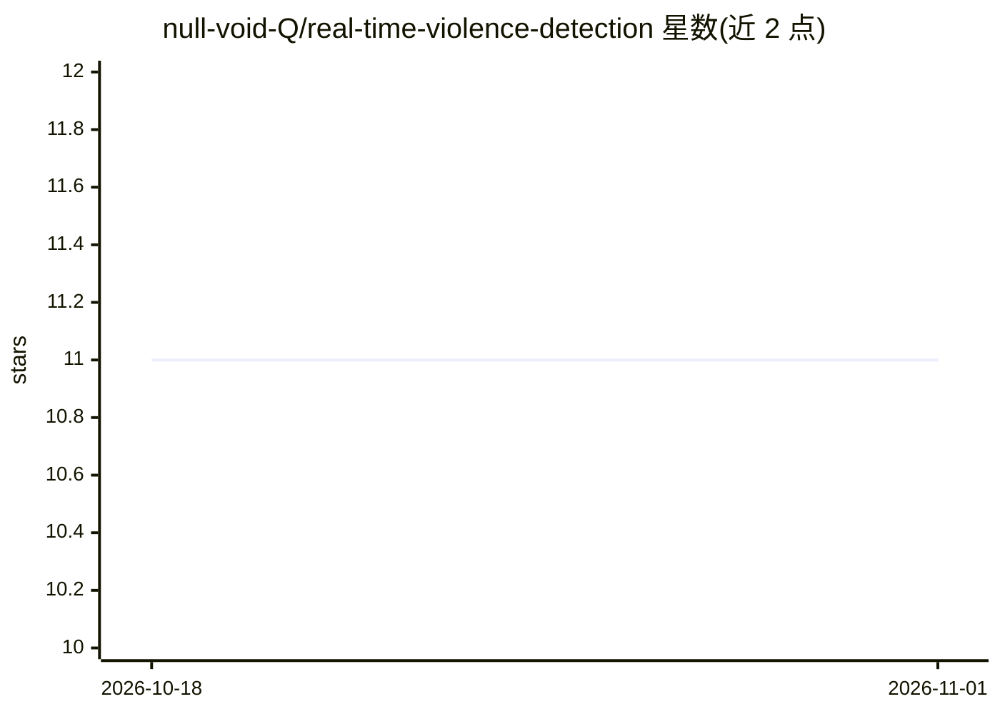

# null-void-Q/real-time-violence-detection

⭐ 11 · Python · 推送 2026-01-06 · [GitHub](https://github.com/null-void-Q/real-time-violence-detection) · 个人维护

**基于 I3D 的实时视频暴力检测演示（Gradio Web 界面）**

端到端视频暴力检测演示：从公开与私有来源收集暴力/非暴力短视频（35k 条、每条 64 帧），经数据整理标注后在自定义数据集上微调 DeepMind Kinetics-I3D 模型，通过 Gradio Web 界面对视频内容实时标记可能的暴力片段，支持摄像头输入（需 localhost 访问）。README 声明非生产级系统：基于较旧 checkpoint 与多样性有限的私有数据集，属概念验证，测试集上准确率 91.6%、召回 84.7%。提供 Docker Compose（GPU/CPU）与 Python 两种运行方式。

## 筛选速览

| 维度 | 判定 | 备注 |
|---|---|---|
| AI 角色 | `ai-native` | 本体是模型或模型工具 |
| 许可风险 | `none` | — |
| 部署形态 | `self-host` | docker 或自建部署 |
| 模型依赖 | — | README 未给出锁定关系 |
| 硬件要求 | — | 无带数字的原话,不猜 |
| 安装摩擦 | `low` | 无编译、无系统依赖或容器化 |
| 成熟度 | `idea` | |

## 能力要点

- Kinetics-I3D 在 35k 条自制视频数据集上微调
- Gradio Web 界面实时检测视频中的暴力内容
- Docker Compose 提供 GPU 与 CPU 两种部署配置
- 作者声明为概念验证，非生产就绪

## 适用场景

- 在浏览器里对视频或摄像头画面做暴力内容实时检测
- 复用或改进 I3D 暴力检测工作流作为研究基线
- 了解视频动作识别模型微调与部署的完整流程

## 场景标签

`目标检测` · 领域:感知与多模态

## 证据(README 行号)

> L8: A lightweight demo that uses a **DeepMind Kinetics‑I3D** backbone, built through end-to-end pipeline: **data collect
> L10: - **Purpose:** Show how an I3D model can be repurposed for real-time violence detection – not a production-ready sy

## 星数曲线

2026-10-18 11 → 2026-11-01 11（+0）

---
*卡片 v1 · prompt 1.4 · 生成 2026-11-01 · 置信度 mid · 依据 README sha `d27b67d276f3` · [字段定义](../../DATASET.md)*
