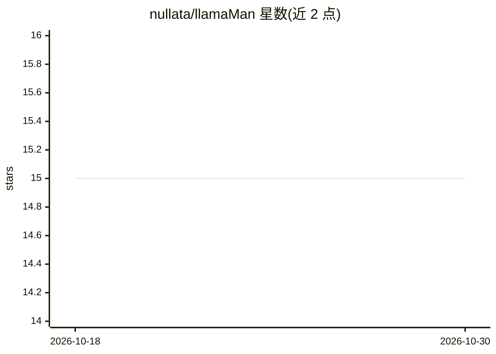

# nullata/llamaMan

⭐ 15 · Python · NOASSERTION · 推送 2026-10-27 · [GitHub](https://github.com/nullata/llamaMan) · [官网](https://nickscripts.com) · 个人维护 · 中文 README

**浏览器 UI 管理/集群化多个 llama.cpp server 实例并代理 API**

面向自托管 LLM 推理运维：以浏览器 UI + API 前端在单机或小型集群上启动、监控多个 llama.cpp server 实例（以 Docker 兄弟容器方式生成，本体不含 llama.cpp 代码与 GPU 依赖），并在 :42069 提供 Ollama/OpenAI 兼容代理，可对接 Open WebUI，支持模型按需自启与 LRU 淘汰。功能含 HuggingFace 模型下载、逐 GPU VRAM 与吞吐监控、多节点集群、认证与 API key、可选知识库 + MCP server 与 Strata 引擎。要求 Docker 及 docker.sock 访问，GPU 按厂商选择对应 llama.cpp 镜像；许可为 Elastic License 2.0。

## 筛选速览

| 维度 | 判定 | 备注 |
|---|---|---|
| AI 角色 | `ai-ecosystem` | LLM/agent 周边工具 |
| 许可风险 | `none` | NOASSERTION |
| 部署形态 | `self-host` | docker 或自建部署 |
| 模型依赖 | local-ok | 支持本地模型 |
| 硬件要求 | — | 无带数字的原话,不猜 |
| 安装摩擦 | `low` | 无编译、无系统依赖或容器化 |
| 成熟度 | — | 结构信号不足 |

## 能力要点

- 经 Docker socket 生成 llama.cpp server 兄弟容器，升级 llama.cpp 只需 pull 新镜像
- Ollama + OpenAI 兼容代理，Open WebUI 可直接替换接入，模型按需自启与 LRU 淘汰
- NVIDIA/AMD/Intel/CPU 统一镜像流程，厂商自动检测
- 可选多节点集群、MariaDB 后端知识库 + MCP server

## 适用场景

- 在一台或多台机器上集中启动和管理多个 llama.cpp 推理实例
- 让 Open WebUI 等 Ollama/OpenAI 客户端按需调用本地模型并自动启停
- 监控各实例的 VRAM、TTFT、吞吐与延迟

## 场景标签

`模型网关` · 领域:Agent 开发

## 证据(README 行号)

> L7: **What it is.** A browser UI + API front-end for running multiple llama.cpp server instances, across one machine or 
> L9: **What's different.** llamaMan itself has **no llama.cpp code and no GPU dependency** - it spawns `ghcr.io/ggml-org/
> L100: llamaMan is a small Python app that never touches llama.cpp code directly. It spawns each `llama-server` as a sibl

## 星数曲线

2026-10-18 15 → 2026-10-30 15（+0）

---
*卡片 v1 · prompt 1.4 · 生成 2026-10-30 · 置信度 high · 依据 README sha `69451295a759` · [字段定义](../../DATASET.md)*
