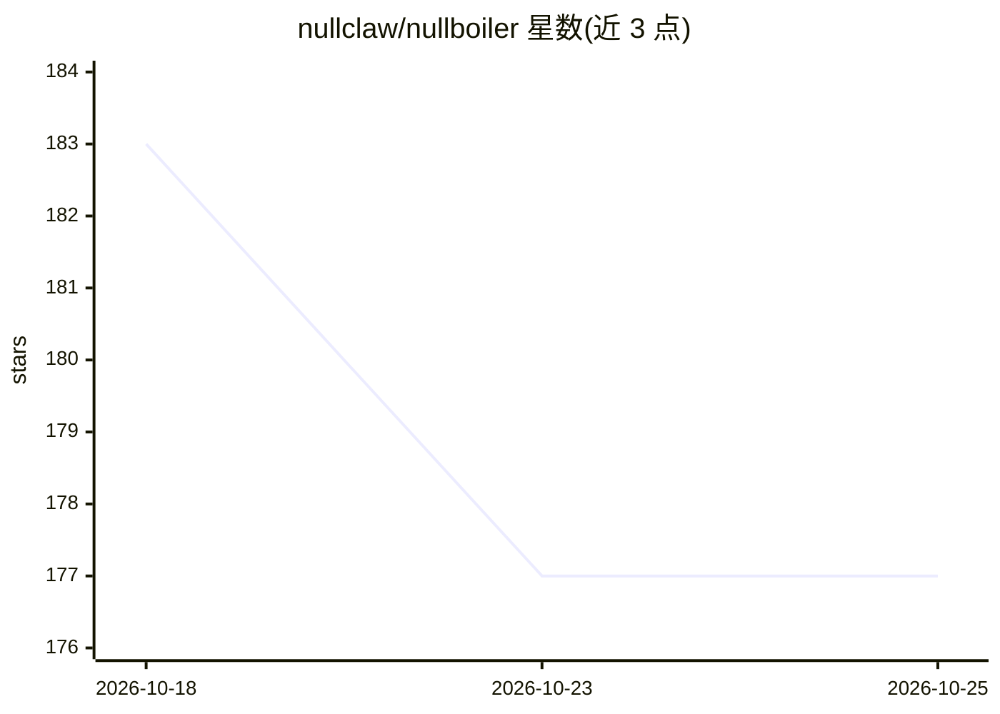

# nullclaw/nullboiler

⭐ 177 · Zig · MIT · 推送 2026-10-04 · [GitHub](https://github.com/nullclaw/nullboiler) · 组织维护

**AI agent 多步工作流编排引擎（Zig 实现），负责任务调度与分发**

用 Zig 编写的 AI agent 编排引擎：从任务追踪器（nulltickets 或其他来源）拉取工作，应用调度与路由策略，执行并发限制、重试与退避，并将任务分发给一个或多个 agent 执行。设计上刻意收窄职责：追踪器持有事实源，本产品只做策略引擎，agent 负责执行；不替代任务追踪器或 agent 运行时。工作流图支持 task/agent/route/send/subgraph 等节点、检查点分叉、断点中断与重放。组件可按需组合使用，无需全部部署。面向搭建多 agent 系统的开发者。

## 筛选速览

| 维度 | 判定 | 备注 |
|---|---|---|
| AI 角色 | `ai-ecosystem` | LLM/agent 周边工具 |
| 许可风险 | `permissive` | MIT |
| 部署形态 | `None` |  |
| 模型依赖 | — | README 未给出锁定关系 |
| 硬件要求 | — | 无带数字的原话,不猜 |
| 安装摩擦 | `low` | 无编译、无系统依赖或容器化 |
| 成熟度 | — | 结构信号不足 |

## 能力要点

- 工作流图支持 task/agent/route/interrupt/send/transform/subgraph 节点
- 检查点分叉、断点中断、运行重放与启动后状态注入
- 调度与路由策略：并发限制、重试、退避
- 可编排 nullclaw 及其他兼容 worker（OpenClaw/OpenAI 兼容、ZeroClaw、PicoClaw 经桥接）

## 适用场景

- 搭建多 agent 工作流，集中管理调度与分发策略
- 配合 nulltickets 作为持久任务源做全量编排
- 用检查点与断点中断调试和恢复 agent 工作流运行

## 场景标签

`多智能体` `工作流自动化` · 领域:Agent 开发

## 证据(README 行号)

> L3: NullBoiler is an orchestration engine for AI agents.
> L5: It is intentionally narrow: it decides what should run, when it should run, and which worker should execute it.
> L32: - Dispatches work to one or many agents/workers.

## 星数曲线

2026-10-18 183 → 2026-10-25 177（-6）

---
*卡片 v1 · prompt 1.4 · 生成 2026-10-22 · 置信度 high · 依据 README sha `084cc929e874` · [字段定义](../../DATASET.md)*
