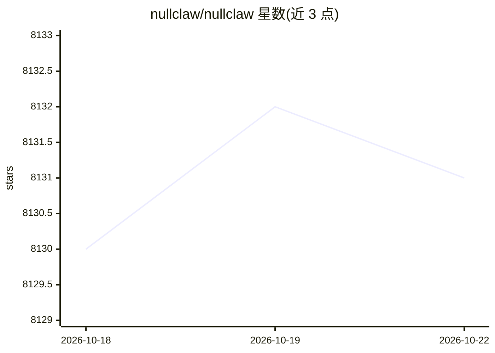

# nullclaw/nullclaw

⭐ 8,131 · Zig · MIT · 推送 2026-10-08 · [GitHub](https://github.com/nullclaw/nullclaw) · [官网](https://nullclaw.io) · 组织维护 · 中文 README

**Zig 编写的自主 AI 助手基础设施，678KB 单二进制运行于边缘设备**

用 Zig 编写的静态单二进制 AI 助手基础设施：678 KB 体积、约 1 MB 峰值内存、毫秒级启动，可运行于 ARM/x86/RISC-V 的廉价开发板。面向需要在边缘或本地部署自主 agent 的开发者：内置 50+ 模型 provider（OpenRouter、Anthropic、Ollama 等）、19 个消息渠道（Telegram、Signal、Lark/飞书等）、35+ 工具、10 种记忆引擎与多层沙箱。所有子系统为 vtable 接口可替换。构建要求 Zig 0.16.0 精确版本，另提供 Homebrew 安装与 Docker Compose 运行方式。

## 筛选速览

| 维度 | 判定 | 备注 |
|---|---|---|
| AI 角色 | `ai-ecosystem` | LLM/agent 周边工具 |
| 许可风险 | `permissive` | MIT |
| 部署形态 | `self-host` | docker 或自建部署 |
| 模型依赖 | local-ok | 支持本地模型 |
| 硬件要求 | — | 无带数字的原话,不猜 |
| 安装摩擦 | `low` | 无编译、无系统依赖或容器化 |
| 成熟度 | `idea` | |

## 能力要点

- 678 KB 静态二进制，约 1 MB 峰值内存，<2 ms 启动
- 50+ provider、19 消息渠道、35+ 工具、10 种记忆引擎
- 全子系统 vtable 接口，配置即可替换实现
- 多层安全：配对码、沙箱（Landlock/Firejail/Bubblewrap/Docker）、ChaCha20-Poly1305 加密密钥

## 适用场景

- 在树莓派等低配开发板上跑一个自主 AI 助手
- 通过 Telegram/Signal 等消息渠道接入自己的 AI agent
- 用 SQLite 混合检索（FTS5+向量）搭建带记忆的助手
- 以 Docker Compose 在本地容器化运行

## 场景标签

`Agent 框架` `Agent 记忆` · 领域:Agent 开发

## 证据(README 行号)

> L18: The smallest fully autonomous AI assistant infrastructure — a static Zig binary that fits on any $5 board, boots in
> L223: |**AI Models**|`Provider`|50+ providers (OpenRouter, Anthropic, OpenAI, Azure OpenAI, Gemini, Vertex AI, Ollama, V
> L224: |**Channels**|`Channel`|CLI, Telegram, Signal, Discord, Slack, iMessage, Matrix, WhatsApp, Webhook, IRC, Lark/Feis

## 星数曲线

2026-10-18 8,130 → 2026-10-22 8,131（+1）

---
*卡片 v1 · prompt 1.4 · 生成 2026-10-20 · 置信度 high · 依据 README sha `a2380ba6ebf7` · [字段定义](../../DATASET.md)*
