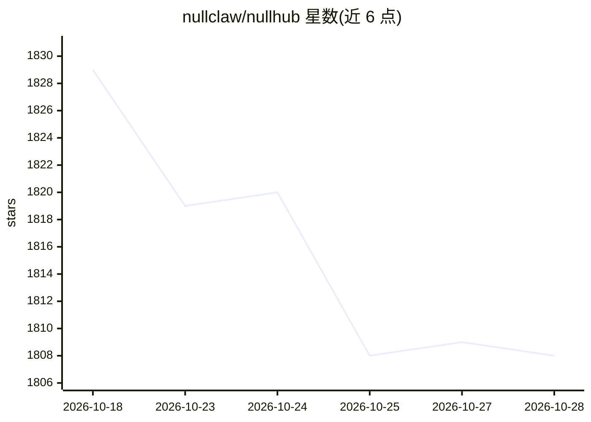

# nullclaw/nullhub

⭐ 1,806 · Zig · MIT · 推送 2026-10-04 · [GitHub](https://github.com/nullclaw/nullhub) · [官网](https://nullhub.io) · 组织维护 · 中文 README

**NullClaw 生态组件的安装配置与监控管理控制台**

以单个 Zig 二进制（内嵌 Svelte Web UI）形式提供的管理中枢，面向 nullclaw 生态组件（NullClaw、NullBoiler、NullTickets、NullWatch）的安装、配置、监控与更新：包含 manifest 驱动的安装向导、进程守护与崩溃恢复、HTTP 健康检查、日志 SSE 实时流、一键更新与回滚、多实例并行、CLI 与浏览器双入口，以及 Mission Control 本地任务回放（含 checkpoint 分叉与遥测）。运行必需 curl 与 tar，构建需 npm，缺失时可尝试经系统包管理器自动安装。

## 筛选速览

| 维度 | 判定 | 备注 |
|---|---|---|
| AI 角色 | `ai-ecosystem` | LLM/agent 周边工具 |
| 许可风险 | `permissive` | MIT |
| 部署形态 | `None` |  |
| 模型依赖 | — | README 未给出锁定关系 |
| 硬件要求 | — | 无带数字的原话,不猜 |
| 安装摩擦 | `low` | 无编译、无系统依赖或容器化 |
| 成熟度 | — | 结构信号不足 |

## 能力要点

- manifest 驱动的通用引擎：安装、配置、健康检查、向导与 UI 模块由各组件清单描述
- 进程守护：启停、重启、退避式崩溃恢复
- Mission Control：确定性本地任务回放、checkpoint 分叉、遥测与失败/恢复对比
- 单一 Zig 二进制内嵌 Svelte UI，状态全部存于 ~/.nullhub/

## 适用场景

- 一站式安装并管理多个 NullClaw 生态组件
- 通过浏览器仪表盘监控组件健康、日志与队列状态
- 回放 agent 任务执行过程并从 checkpoint 分叉恢复

## 场景标签

 · 领域:AI agent 基础设施/运维工具

## 证据(README 行号)

> L10: `NullHub` is a single Zig binary with an embedded Svelte web UI for installing,
> L25: - **Managed instance admin API** -- instance-scoped status, config, models, cron, channels, and skills routes for m

## 星数曲线

2026-10-18 1,829 → 2026-10-28 1,808（-21）

---
*卡片 v1 · prompt 1.4 · 生成 2026-10-21 · 置信度 high · 依据 README sha `52b909ea98bb` · [字段定义](../../DATASET.md)*
