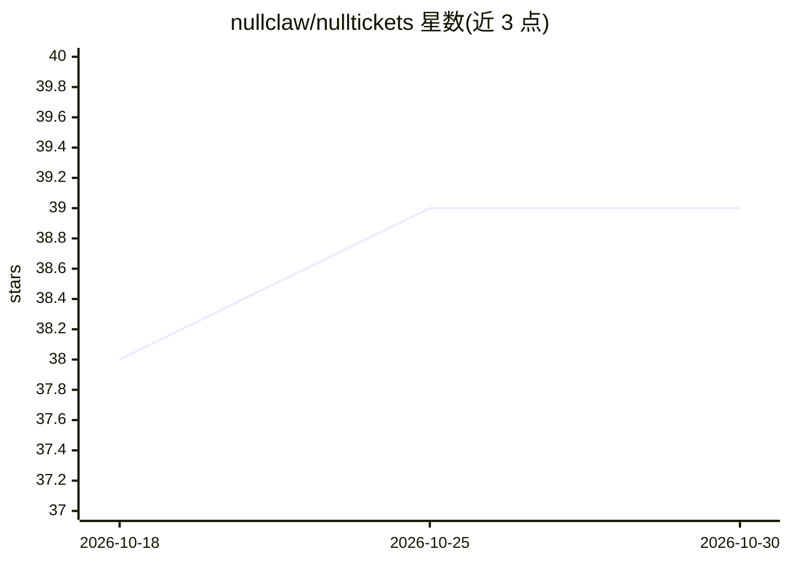

# nullclaw/nulltickets

⭐ 39 · Zig · MIT · 推送 2026-10-04 · [GitHub](https://github.com/nullclaw/nulltickets) · 个人维护

**面向自主 AI agent 的无头任务追踪与持久存储服务**

单个 Zig 二进制、以 SQLite 为后端的任务追踪器，通过 REST API 为流水线式 agent 执行提供任务认领（按角色 lease）、进度事件、阶段流转、产物挂载与依赖/分配管理，并附带跨会话的命名空间 KV 存储与 FTS5 全文检索。自身不运行 agent 进程、不做全局调度，可搭配 nullclaw 运行时与可选的 nullboiler 编排层，也可对接任何实现 tracker 契约的其他 agent 运行时。还提供 OpenAPI 3.1 schema 与 OTLP traces 接入端点。需用 Zig 0.16.0 从源码构建。

## 筛选速览

| 维度 | 判定 | 备注 |
|---|---|---|
| AI 角色 | `ai-ecosystem` | LLM/agent 周边工具 |
| 许可风险 | `permissive` | MIT |
| 部署形态 | `None` |  |
| 模型依赖 | — | README 未给出锁定关系 |
| 硬件要求 | — | 无带数字的原话,不猜 |
| 安装摩擦 | `low` | 无编译、无系统依赖或容器化 |
| 成熟度 | — | 结构信号不足 |

## 能力要点

- lease 式任务认领、心跳续约与阶段流转的持久化状态管理
- 命名空间 KV 存储带 FTS5 全文检索与 JSON 过滤
- 提供 OpenAPI 3.1 schema 与 OTLP traces 接入端点
- 可独立于 nullclaw/nullboiler，对接任意实现 tracker 契约的 agent 运行时

## 适用场景

- 为自主 agent 流水线提供持久的任务积压与执行协调
- 多 agent 会话间通过共享 KV 存储与全文检索传递状态
- 追踪长时自治任务的执行历史、事件与产物

## 场景标签

`Agent 记忆` · 领域:Agent 开发

## 证据(README 行号)

> L3: Headless task tracker for autonomous AI agents.
> L17: `nullTickets` should be treated as the task tracker and source of truth for AI-agent execution.

## 星数曲线

2026-10-18 38 → 2026-10-30 39（+1）

---
*卡片 v1 · prompt 1.4 · 生成 2026-10-25 · 置信度 high · 依据 README sha `b782935f74c3` · [字段定义](../../DATASET.md)*
