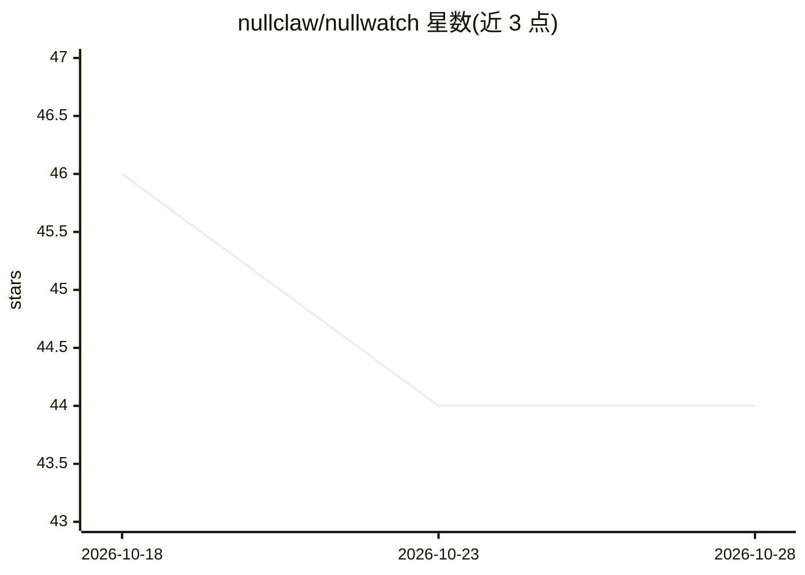

# nullclaw/nullwatch

⭐ 44 · Zig · 推送 2026-10-03 · [GitHub](https://github.com/nullclaw/nullwatch) · 组织维护

**nullclaw 的追踪、评测与可观测性执行智能层**

面向 nullclaw agent 执行遥测的无头（headless）服务：摄入 run/span 追踪数据与评测结果，本地 JSONL 持久化存储，通过 JSON HTTP API（默认 127.0.0.1:7710，含 OTLP/HTTP ingest）与 CLI 暴露，供 nullhub 或其他客户端消费。数据模型覆盖 span（模型调用、工具调用等）、eval（打分断言）与 run 摘要（延迟、成本、token 用量）。单二进制用 Zig 构建，不承担调度、编排或 UI 职责；存储后续计划换为 SQLite。另提供零依赖的 Python SDK。

## 筛选速览

| 维度 | 判定 | 备注 |
|---|---|---|
| AI 角色 | `ai-ecosystem` | LLM/agent 周边工具 |
| 许可风险 | `none` | — |
| 部署形态 | `None` |  |
| 模型依赖 | — | README 未给出锁定关系 |
| 硬件要求 | — | 无带数字的原话,不猜 |
| 安装摩擦 | `low` | 无编译、无系统依赖或容器化 |
| 成熟度 | `idea` | |

## 能力要点

- span/eval/run 摘要三级数据模型，含成本与 token 统计
- JSON HTTP API 与 CLI 双通道，支持 OTLP/HTTP traces 摄入
- demo-seed 生成确定性本地演示数据，无需 API key 或托管服务
- 通过 --export-manifest 与 nullhub 集成

## 适用场景

- 为 nullclaw agent 运行记录与查询执行追踪、评测结果和成本
- 按 dataset/verdict 过滤查询失败评测做回归检查
- 本地开发中用 demo-seed 生成演示数据供 UI 消费

## 场景标签

`LLM 可观测性` `模型评测` · 领域:评测与运维

## 证据(README 行号)

> L3: Observability, tracing, evals, and optimization signals for `nullclaw`.
> L5: `nullwatch` is the execution-intelligence layer in the `null*` stack. It does not run agents, it does not schedule w
> L26: - Eval result ingest for scorers, rubrics, regression checks, and datasets.

## 星数曲线

2026-10-18 46 → 2026-10-28 44（-2）

---
*卡片 v1 · prompt 1.4 · 生成 2026-10-25 · 置信度 high · 依据 README sha `4c89cbf99b7f` · [字段定义](../../DATASET.md)*
