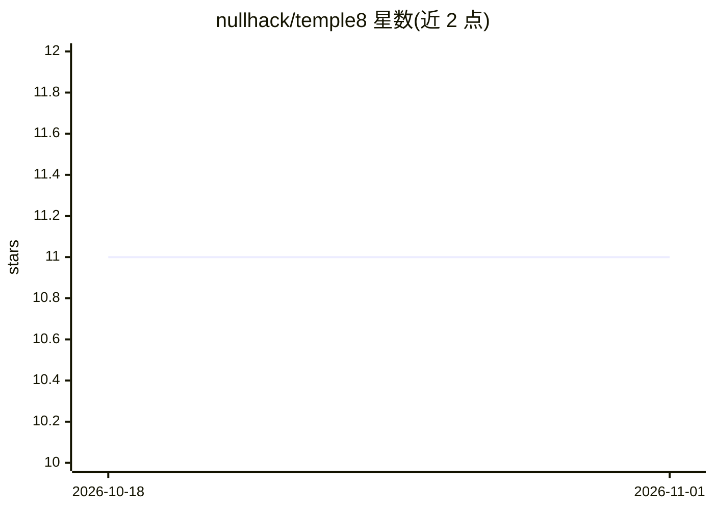

# nullhack/temple8

⭐ 11 · Jinja · MIT · 推送 2026-10-26 · [GitHub](https://github.com/nullhack/temple8) · [官网](https://nullhack.github.io/temple8/) · 个人维护

**测试驱动的 agent 编排项目模板：以测试为契约、状态机路由**

面向从'氛围编程'转向结构化 agent 工程的开发者与团队的 Python 项目模板（copier 模板）。将测试桩提前从访谈中编写为契约，在任何源码存在前先做模拟仿真，再按 red→green→refactor 逐契约构建；用 flowr 状态机（YAML 定义）路由每个状态变更到指定的专家 agent 与技能，CI（ruff/pyright/mypy.stubtest/pytest）作为执行底线。通过 opencode 或兼容的 agent runner 接入任意 LLM，MIT 许可，无订阅或供应商账号要求；已有项目可用 agents-smith 一条命令引入。

## 筛选速览

| 维度 | 判定 | 备注 |
|---|---|---|
| AI 角色 | `ai-ecosystem` | LLM/agent 周边工具 |
| 许可风险 | `permissive` | MIT |
| 部署形态 | `library` | 以包/库形式分发 |
| 模型依赖 | — | README 未给出锁定关系 |
| 硬件要求 | — | 无带数字的原话,不猜 |
| 安装摩擦 | `low` | 无编译、无系统依赖或容器化 |
| 成熟度 | — | 结构信号不足 |

## 能力要点

- 测试桩先于源码编写并通过契约模拟门（contract simulation gate）检验
- YAML 状态机 flowr 路由状态变更，按证据门控制流转
- discover→explore→plan→build→deliver→shipped 六阶段流水线，每状态命名专家 agent
- copier 模板创建新项目，agents-smith 一条命令接入已有 Python 项目

## 适用场景

- 让 AI 编程助手按 BDD/TDD 契约开发而非自由发挥
- 团队在现有流程（Scrum/Kanban/自定义）上叠加结构化 agent 编排
- 在本地用任意 LLM 试用测试驱动开发纪律

## 场景标签

`Agent 框架` · 领域:Agent 开发

## 证据(README 行号)

> L17: **temple8 makes tests the contract and a state machine the router.** Test stubs are authored up front from the inte
> L121: Claude Code and opencode are general-purpose agent runners. temple8 gives them a process: YAML state machines, sco

## 星数曲线

2026-10-18 11 → 2026-11-01 11（+0）

---
*卡片 v1 · prompt 1.4 · 生成 2026-11-01 · 置信度 mid · 依据 README sha `1faaf2aa6e7e` · [字段定义](../../DATASET.md)*
