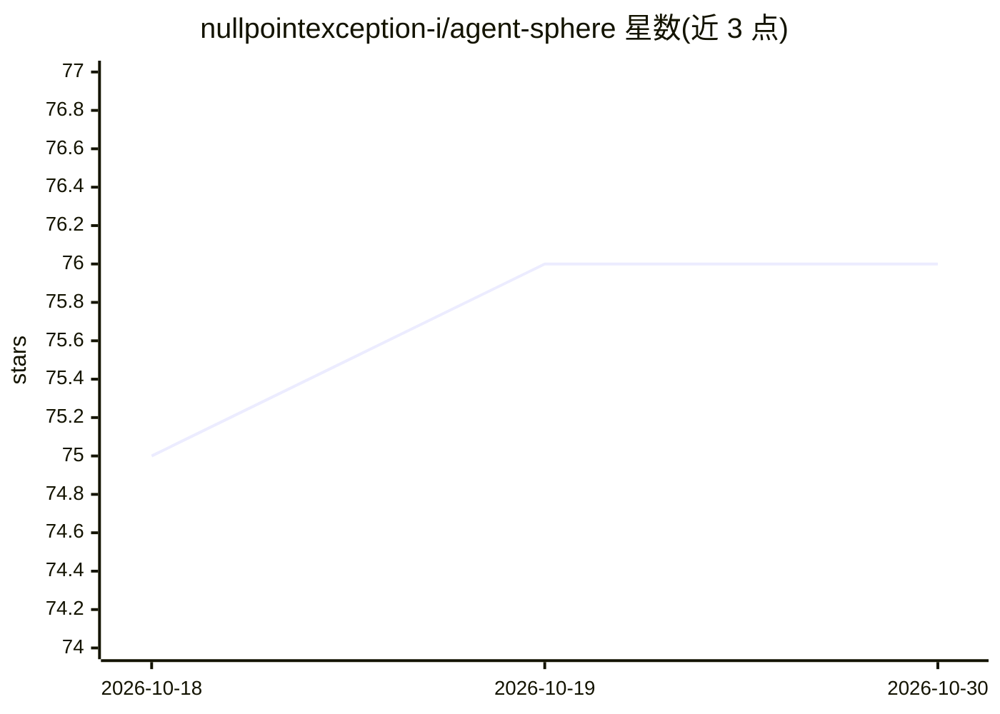

# nullpointexception-i/agent-sphere

⭐ 76 · Java · MIT · 推送 2026-10-29 · [GitHub](https://github.com/nullpointexception-i/agent-sphere) · [官网](http://as.buukle.top) · 个人维护 · 中文 README

**面向开发者的 Java 版 AI Agent 编排平台**

基于 Spring Boot 3.4.3 / Java 21 / React 19 的 AI Agent 编排平台：以 LLM ReAct 决策引擎驱动 Plan→Act→Observe→Learn 闭环，支持多 Agent 子任务委派与 DAG 编排、MCP 协议、内置 SPI 工具、CLI 执行与 Chrome 扩展桥接的真实浏览器自动化（含截图视觉观测与像素级点击）。可配置 OpenAI、DeepSeek、智谱、LiteLLM 等多家模型提供商及主备路由。另有 OIDC SSO、RBAC、技能市场（发布/安装 fork/自动更新）与可嵌入聊天组件。安装细节见 QUICK_START.md，README 未展示具体命令。

## 筛选速览

| 维度 | 判定 | 备注 |
|---|---|---|
| AI 角色 | `ai-ecosystem` | LLM/agent 周边工具 |
| 许可风险 | `permissive` | MIT |
| 部署形态 | `library` | 以包/库形式分发 |
| 模型依赖 | locked-api |  |
| 硬件要求 | — | 无带数字的原话,不猜 |
| 安装摩擦 | `medium` | 含编译或系统依赖之一 |
| 成熟度 | — | 结构信号不足 |

## 能力要点

- ReAct 引擎多 Agent 编排与 DAG 任务分层并行
- 统一能力层：MCP、内置 SPI 工具、CLI、Chrome 扩展浏览器自动化
- 多模型提供商路由与主备降级
- Skill Hub 技能市场：发布、fork 安装、版本自动同步

## 适用场景

- 搭建带工具调用与浏览器操作能力的多 Agent 系统
- 通过 MCP 接入 Jira/GitHub/Slack 等系统执行跨系统工作流
- 在第三方页面嵌入带 SSO 的聊天组件对外提供 Agent 能力

## 场景标签

`Agent 框架` `多智能体` `浏览器自动化` · 领域:Agent 开发

## 证据(README 行号)

> L15: This project is an AI Agent orchestration platform. Driven by an LLM-based decision engine and combined with capabi
> L43: - **LLM ReAct orchestration** — `SessionRunner` runs a `Plan → Act → Observe → Learn` loop with per-turn timeout, c
> L44: - **Multi-agent sub-runs** — a parent run can delegate sub-tasks to **sub-agents** via the unified **`delegate` too

## 星数曲线

2026-10-18 75 → 2026-10-30 76（+1）

---
*卡片 v1 · prompt 1.4 · 生成 2026-10-24 · 置信度 mid · 依据 README sha `e875507e8af7` · [字段定义](../../DATASET.md)*
