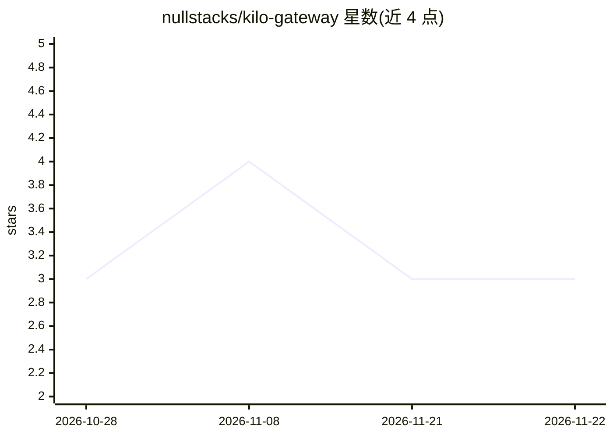

# nullstacks/kilo-gateway

⭐ 3 · Python · 推送 2026-10-20 · [GitHub](https://github.com/nullstacks/kilo-gateway) · 个人维护

**将 Kilo 免费模型暴露为 OpenAI/Anthropic 兼容端点的无密钥网关**

以透明代理方式接入 Kilo 免费层（无需账号与 API key），提供 /v1/models 免费模型目录（每 5 分钟刷新）与 OpenAI Chat/Responses、Anthropic Messages 三种线协议端点。提供两种运行时：Cloudflare Worker（npx wrangler deploy）或本地/VPS 的 Python Flask 服务器（含 Dockerfile），行为一致。真实 Kilo key 转发规则使 harness 占位 key 不影响免费层；部分模型有上游每日限额。

## 筛选速览

| 维度 | 判定 | 备注 |
|---|---|---|
| AI 角色 | `ai-ecosystem` | LLM/agent 周边工具 |
| 许可风险 | `none` | — |
| 部署形态 | `self-host` | docker 或自建部署 |
| 模型依赖 | — | README 未给出锁定关系 |
| 硬件要求 | — | 无带数字的原话,不猜 |
| 安装摩擦 | `low` | 无编译、无系统依赖或容器化 |
| 成熟度 | — | 结构信号不足 |

## 能力要点

- 同一 API 的两种运行时：Cloudflare Worker 与 Python Flask（含 Dockerfile）
- 同时暴露 OpenAI Chat/Responses 与 Anthropic Messages 三种线协议
- /v1/models 实时免费模型目录，每 5 分钟刷新并附上下文/模态注记
- 仅转发形似真实 Kilo key 的请求头，兼容 harness 占位 key

## 适用场景

- 给 OpenCode 等 OpenAI 兼容工具接入 Kilo 免费模型
- 自建网关在本地/VPS/边缘运行而无密钥配置
- 查询 Kilo 免费层的实时模型目录与可用状态

## 场景标签

`模型网关` · 领域:Agent 开发

## 证据(README 行号)

> L3: **Kilo Gateway's free models** (no account, no API key, no fingerprinting) as
> L24: Kilo's free tier (`api.kilo.ai/api/gateway`) requires **no auth at all** and
> L62: POST /v1/chat/completions  OpenAI Chat wire (stream + non-stream)

## 星数曲线

2026-10-28 3 → 2026-11-22 3（+0）

---
*卡片 v1 · prompt 1.4 · 生成 2026-11-21 · 置信度 high · 依据 README sha `8537be78423a` · [字段定义](../../DATASET.md)*
