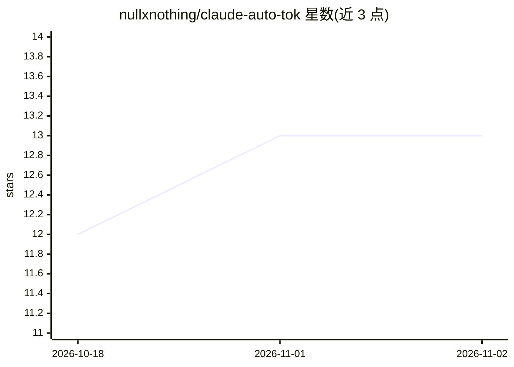

# nullxnothing/claude-auto-tok

⭐ 13 · TypeScript · 推送 2026-04-03 · [GitHub](https://github.com/nullxnothing/claude-auto-tok) · [官网](https://github.com/nullxnothing/claude-auto-tok#demo) · 个人维护

**一条命令生成可发布 TikTok 视频的六 agent 自动化流水线**

面向内容创作者/开发者的自动化短视频生成工具：以 pnpm swarm:run 启动六 agent 流水线——Researcher（Gemini 抓取 TikTok 趋势并做 GO/WAIT/PIVOT 门控）、Scriptwriter（Claude 经 OpenRouter 生成脚本）、Voice Producer（ElevenLabs 合成带词级时间戳的配音）、Visual Director（Pexels/Kling 取素材）、Composer（Remotion 渲染 9:16 视频，6 套模板）、Reviewer（Gemini 2.5 Pro 按 20 分量表质检，最多 2 轮返修）。需 5 个必填 API key，依赖 Node.js 18+、pnpm 与 Chrome/Chromium；单条视频成本约 $0.05，自动化发布还需 TikTok API 审批（3-4 周）。

## 筛选速览

| 维度 | 判定 | 备注 |
|---|---|---|
| AI 角色 | `ai-native` | 本体是模型或模型工具 |
| 许可风险 | `none` | — |
| 部署形态 | `library` | 以包/库形式分发 |
| 模型依赖 | locked-api |  |
| 硬件要求 | — | 无带数字的原话,不猜 |
| 安装摩擦 | `low` | 无编译、无系统依赖或容器化 |
| 成熟度 | — | 结构信号不足 |

## 能力要点

- 六 agent 分工：趋势研究→脚本→配音→视觉→渲染→多模态质检
- 20 分量表 QA 与定向返修循环（最多 2 轮，指名返修对象）
- 词级时间戳实现字幕精确同步，渲染前校验时长
- 趋势 GO/WAIT/PIVOT 门控提前止损，节省 API 调用

## 适用场景

- 输入一个主题自动产出可直接发布的 TikTok 视频
- 配合 VPS cron 实现每日定时出片
- 在 Remotion Studio 中预览调整视频模板

## 场景标签

`多智能体` `视频生成` · 领域:Agent 开发

## 证据(README 行号)

> L8: **AI-powered TikTok content factory.** Six autonomous agents research trends, write viral scripts, generate voiceove
> L23: Topic In ──► Researcher ──► Scriptwriter ──► Voice Producer ──► Visual Director ──► Composer ──► Reviewer ──► Video
> L35: |1|**Researcher**|`gemini-2.5-flash`|Pulls top 20 TikToks via ScrapeCreators, scores hooks, checks trend timing (ri

## 星数曲线

2026-10-18 12 → 2026-11-02 13（+1）

---
*卡片 v1 · prompt 1.4 · 生成 2026-10-31 · 置信度 mid · 依据 README sha `3f687a7854c9` · [字段定义](../../DATASET.md)*
