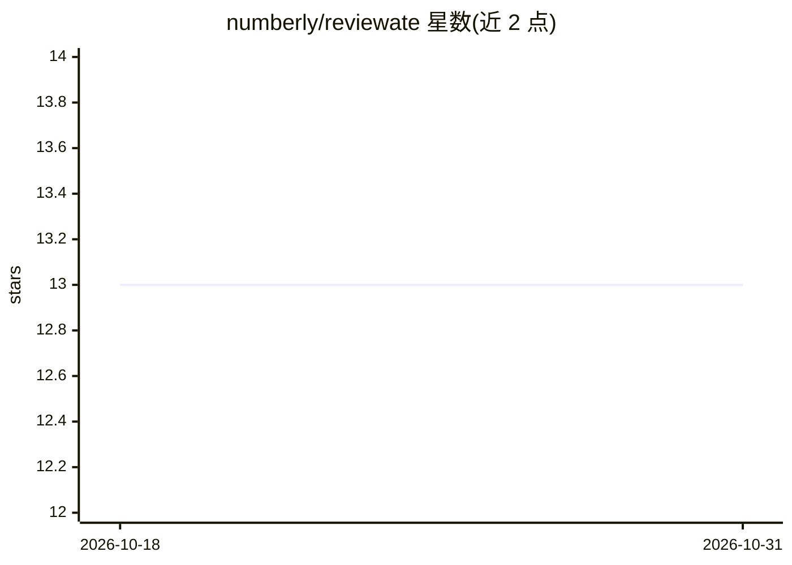

# numberly/reviewate

⭐ 13 · Python · AGPL-3.0 · 推送 2026-10-21 · [GitHub](https://github.com/numberly/reviewate) · [官网](https://reviewate.com) · 组织维护

**开源 AI 代码审查 agent，审查 GitHub/GitLab PR**

基于 Claude Agent SDK 构建的 AI 代码审查 agent，面向使用 GitHub 和 GitLab 的开发团队。采用多 agent 流水线分析代码变更、探索代码库获取上下文、对每条发现做事实核查，并将可执行的反馈直接发到 PR 上。CLI 方式通过 uv/pip 安装（需 Python ≥3.13），复用 gh/glab 登录，首次运行提示配置模型；亦支持自托管部署，提供 dashboard、webhook、容器隔离执行、Docker Compose/Kubernetes 等。

## 筛选速览

| 维度 | 判定 | 备注 |
|---|---|---|
| AI 角色 | `ai-ecosystem` | LLM/agent 周边工具 |
| 许可风险 | `viral` | AGPL-3.0 |
| 部署形态 | `self-host` | docker 或自建部署 |
| 模型依赖 | locked-api |  |
| 硬件要求 | — | 无带数字的原话,不猜 |
| 安装摩擦 | `low` | 无编译、无系统依赖或容器化 |
| 成熟度 | — | 结构信号不足 |

## 能力要点

- 多 agent 流水线：分析变更、探索代码库、事实核查每条发现
- 对 GitHub 与 GitLab PR 直接发布可执行反馈
- 复用 gh/glab 登录，CLI 单命令审查指定 PR
- 支持自托管：dashboard、webhook、容器隔离执行

## 适用场景

- 让 AI 审查我的 GitHub/GitLab 拉取请求并获得带核查的反馈
- 在自有基础设施上为团队部署 AI 代码审查服务
- 在 CI/CD 流程中集成自动化代码审查

## 场景标签

`代码审查` · 领域:编码与开发

## 证据(README 行号)

> L5:  Open-source AI code reviewer for GitHub and GitLab
> L11: Reviewate is an AI agent that reviews your pull requests. Built on the Claude Agent SDK, it uses a multi-agent pipe

## 星数曲线

2026-10-18 13 → 2026-10-31 13（+0）

---
*卡片 v1 · prompt 1.4 · 生成 2026-10-31 · 置信度 mid · 依据 README sha `fd515035e4ad` · [字段定义](../../DATASET.md)*
