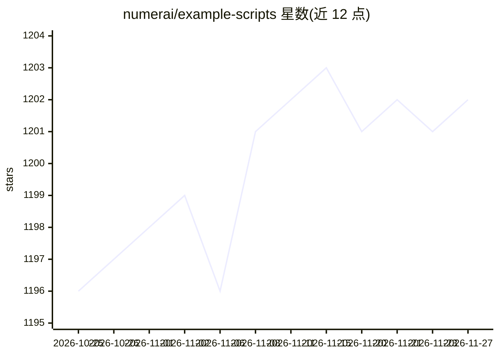

# numerai/example-scripts

⭐ 1,202 · Jupyter Notebook · MIT · 推送 2026-11-18 · [GitHub](https://github.com/numerai/example-scripts) · [官网](https://numer.ai/) · 组织维护

**Numerai 锦标赛官方入门脚本与教程笔记本集合**

Numerai 官方提供的入门资料库：包含代理（Agent）使用示例——克隆仓库后安装 MCP 脚本并执行自然语言任务；数据构建示例（用本地语言模型给 SEC 文件打分并按 ticker/日期拼接特征、时序滚动特征构建）；以及 Colab 教程笔记本，覆盖数据集探索、首个模型搭建和模型上传流程。面向参加 Numerai 锦标赛的用户，要求具备 git 与命令行使用能力。

## 筛选速览

| 维度 | 判定 | 备注 |
|---|---|---|
| AI 角色 | `ai-knowledge` | 知识聚合/清单类 |
| 许可风险 | `permissive` | MIT |
| 部署形态 | `None` |  |
| 模型依赖 | — | README 未给出锁定关系 |
| 硬件要求 | — | 无带数字的原话,不猜 |
| 安装摩擦 | `low` | 无编译、无系统依赖或容器化 |
| 成熟度 | — | 结构信号不足 |

## 能力要点

- Agent 使用路径：git clone + 安装 MCP 脚本 + 自然语言执行任务
- 用本地语言模型对 SEC 财报打分并构建特征
- 提供 hello_numerai 与模型上传两个 Colab 教程笔记本
- 官方入门入口，指向 Discord 社区支持

## 适用场景

- 初次参加 Numerai 锦标赛需要快速上手
- 用 AI 代理探索并构建预测特征
- 按教程搭建并上传首个模型

## 场景标签

`金融量化` `教程课程` · 领域:学习与行业

## 证据(README 行号)

> L1: # Numerai Example Scripts
> L2: The official place to start playing the Numerai tournaments.
> L21: We highly recommend getting started with Agents using the above section. But, if you're looking to kill some time o

## 星数曲线

2026-10-25 1,196 → 2026-11-27 1,202（+6）

---
*卡片 v1 · prompt 1.4 · 生成 2026-11-23 · 置信度 high · 依据 README sha `2e144c960651` · [字段定义](../../DATASET.md)*
