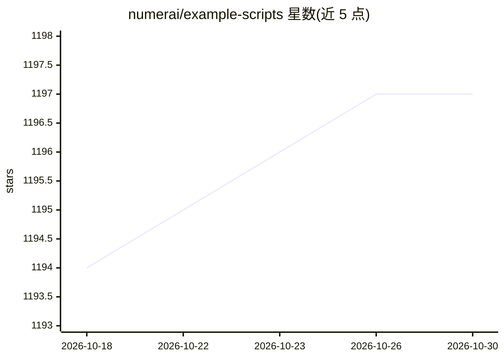

# numerai/example-scripts

⭐ 1,197 · Jupyter Notebook · MIT · 推送 2026-10-29 · [GitHub](https://github.com/numerai/example-scripts) · [官网](https://numer.ai/) · 组织维护

**Numerai 官方入门脚本与教程 notebook 合集**

Numerai 官方维护的示例仓库，帮助用户快速上手其数据科学锦标赛：提供教程 notebook（探索数据集、构建并上传第一个模型，可在线在 Colab 打开），以及使用 AI agent 的入门路径——克隆仓库后安装 Numerai MCP 脚本，用 codex 执行自然语言指令（如寻找预测目标的最优神经网络架构）。面向参与 Numerai 锦标赛的数据科学与量化建模用户。

## 筛选速览

| 维度 | 判定 | 备注 |
|---|---|---|
| AI 角色 | `ai-knowledge` | 知识聚合/清单类 |
| 许可风险 | `permissive` | MIT |
| 部署形态 | `None` |  |
| 模型依赖 | — | README 未给出锁定关系 |
| 硬件要求 | — | 无带数字的原话,不猜 |
| 安装摩擦 | `low` | 无编译、无系统依赖或容器化 |
| 成熟度 | — | 结构信号不足 |

## 能力要点

- 官方入门 notebook：探索数据集并构建上传模型
- 可在 Google Colab 中直接打开运行教程
- 提供 agent 工作流：安装 Numerai MCP 后用 codex 自然语言驱动

## 适用场景

- 作为 Numerai 锦标赛的新手起点
- 在 Colab 中快速跑通第一个 Numerai 模型
- 用 AI agent 方式探索数据并构建预测模型

## 场景标签

`金融量化` `教程课程` · 领域:学习与行业

## 证据(README 行号)

> L2: The official place to start playing the Numerai tournaments.
> L18: - Hello Numerai: Start here if you are new! Explore the dataset and build your first model. <a target="_blank" href

## 星数曲线

2026-10-18 1,194 → 2026-10-30 1,197（+3）

---
*卡片 v1 · prompt 1.4 · 生成 2026-10-21 · 置信度 high · 依据 README sha `5b54caf5b9fd` · [字段定义](../../DATASET.md)*
