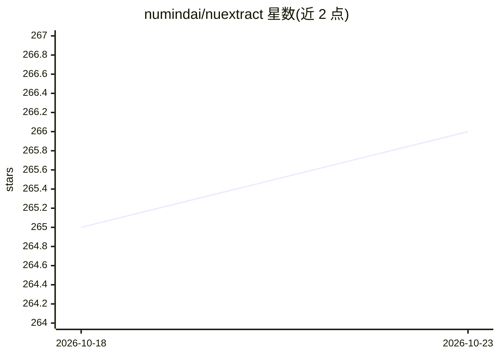

# numindai/nuextract

⭐ 266 · Jupyter Notebook · MIT · 推送 2026-08-17 · [GitHub](https://github.com/numindai/nuextract) · 组织维护

**4B 视觉语言模型：从文档/图像抽取结构化信息并转 Markdown**

NuMind 发布的 4B 统一视觉语言推理模型 NuExtract3，面向文档理解：输入文本或图像加 JSON 模板即可输出结构化抽取结果，支持 verbatim-string、date-time 等类型及枚举/数组构造器；也可将文档图像转换为 Markdown（表格用 HTML、公式用 LaTeX）。支持多语言、多模态输入、推理与非推理两种模式、上下文示例及从自然语言生成抽取模板。可通过 vLLM 以 OpenAI 兼容 API 部署，或直接用 transformers 运行；官方 Python SDK 提供 JSON schema/Pydantic 转模板方法。

## 筛选速览

| 维度 | 判定 | 备注 |
|---|---|---|
| AI 角色 | `ai-native` | 本体是模型或模型工具 |
| 许可风险 | `permissive` | MIT |
| 部署形态 | `library` | 以包/库形式分发 |
| 模型依赖 | local-ok | 支持本地模型 |
| 硬件要求 | — | 无带数字的原话,不猜 |
| 安装摩擦 | `low` | 无编译、无系统依赖或容器化 |
| 成熟度 | — | 结构信号不足 |

## 能力要点

- 结构化抽取：文本/图像 + JSON 模板 → JSON 输出，支持 ICL 示例
- 文档图像转 Markdown（HTML 表格、LaTeX 公式、figure 描述）
- 推理与非推理双模式，可按文档难度切换
- vLLM 部署支持 OpenAI 兼容 API 与 Multi Token Prediction 推测解码

## 适用场景

- 从发票、合同、表单等文档批量抽取结构化字段
- 将扫描件或复杂版式文档转换为 Markdown 供 RAG 预处理
- 多页 PDF 逐页渲染后做图像抽取

## 场景标签

`文档解析` `多模态` · 领域:知识与检索

## 证据(README 行号)

> L10: **NuExtract3** is a unified **4B** vision-language reasoning model for document understanding.
> L12: It combines strong **structured information extraction** with high-quality **image-to-Markdown** conversion, making
> L18: - **Structured extraction**: input (text/images) + JSON template + instructions --> JSON output

## 星数曲线

2026-10-18 265 → 2026-10-23 266（+1）

---
*卡片 v1 · prompt 1.4 · 生成 2026-10-22 · 置信度 high · 依据 README sha `a36a0eaa6031` · [字段定义](../../DATASET.md)*
