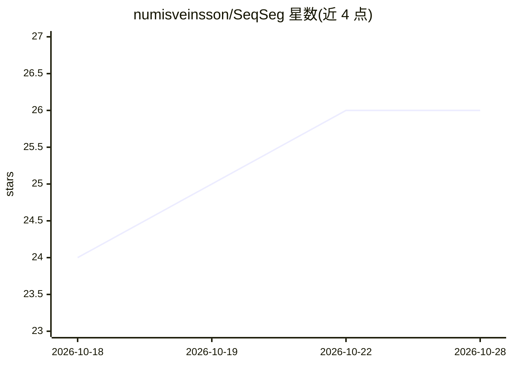

# numisveinsson/SeqSeg

⭐ 26 · Python · Apache-2.0 · 推送 2026-10-27 · [GitHub](https://github.com/numisveinsson/SeqSeg) · 个人维护

**从 1–2 个种子点自动分割追踪 CT/MR 血管的深度学习工具**

SeqSeg 对 CT 和 MR 三维医学图像中的血管做顺序分割与追踪：沿血管中心线逐步推进，检测分叉以生长完整血管树，仅需 1–2 个种子点初始化。机制上结合 nnU-Net 局部深度学习预测与几何追踪，覆盖约 1mm 冠脉到约 30mm 主动脉的尺度，提供主动脉 CT/MR 与冠脉 CT 预训练权重，输出可直接在 SimVascular 打开的项目（含 pathlines 与 contours）。以 pip 包 + CLI 形式提供，需另从 Zenodo 下载权重；也支持在自有数据上训练 nnU-Net 模型。

## 筛选速览

| 维度 | 判定 | 备注 |
|---|---|---|
| AI 角色 | `ai-native` | 本体是模型或模型工具 |
| 许可风险 | `permissive` | Apache-2.0 |
| 部署形态 | `library` | 以包/库形式分发 |
| 模型依赖 | — | README 未给出锁定关系 |
| 硬件要求 | — | 无带数字的原话,不猜 |
| 安装摩擦 | `low` | 无编译、无系统依赖或容器化 |
| 成熟度 | — | 结构信号不足 |

## 能力要点

- 1–2 个种子点即可生长完整血管树，自动检测分叉
- 结合 nnU-Net 局部预测与几何追踪，适配 CT 与 MR
- 提供主动脉 CT/MR、冠脉 CT 预训练权重（Zenodo 下载）
- 输出含 pathlines 与 contours 的 SimVascular 项目，并提供 Python API

## 适用场景

- 在 CT/MR 影像中分割冠脉、主动脉、脑血管等血管树
- 用少量种子点获得可导入 SimVascular 的血管模型
- 在自己的数据集上训练新的血管分割模型

## 场景标签

`目标检测` · 领域:感知与多模态

## 证据(README 行号)

> L9:  Automatic tracking and segmentation of blood vessels in CT and MR images using deep learning and geometric tracking
> L17: SeqSeg segments vessels **sequentially**, taking steps along vessel centerlines and detecting bifurcations to grow 
> L23: - ✅ **Clinically validated** — coronary, aortic, cerebral, and pulmonary anatomies (pre-trained weights for aorta C

## 星数曲线

2026-10-18 24 → 2026-10-28 26（+2）

---
*卡片 v1 · prompt 1.4 · 生成 2026-10-26 · 置信度 high · 依据 README sha `20891170ded5` · [字段定义](../../DATASET.md)*
