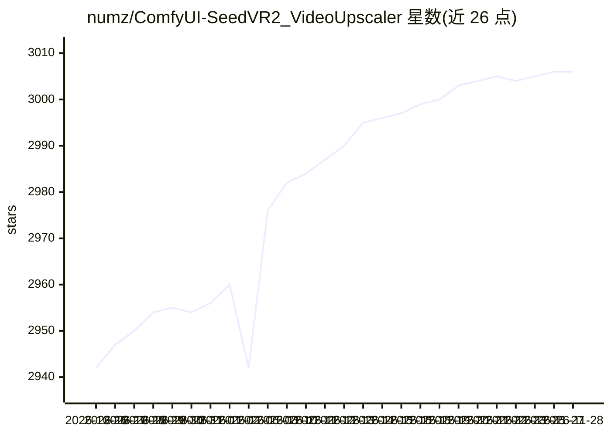

# numz/ComfyUI-SeedVR2_VideoUpscaler

⭐ 3,006 · Python · Apache-2.0 · 推送 2026-11-26 · [GitHub](https://github.com/numz/ComfyUI-SeedVR2_VideoUpscaler) · 组织维护

**ComfyUI 的 SeedVR2 视频与图像超分辨率自定义节点**

为 ComfyUI 提供 SeedVR2 模型接入的自定义节点，对视频和图像执行超分辨率放大，也可作为多 GPU 独立 CLI 运行。支持 GGUF 量化模型、多种注意力后端（Flash Attention 2/3、SageAttention、CUDNN）与自动回退链，覆盖 CUDA、ROCm、Apple MPS 平台，具备 BlockSwap、模型缓存、分块流式处理等显存优化手段。自 ComfyUI v0.28.0 原生支持 SeedVR2 后，本仓库停止维护，末版为 2.5.24（2025 年 12 月），页面与模型保留供既有工作流使用。

## 筛选速览

| 维度 | 判定 | 备注 |
|---|---|---|
| AI 角色 | `ai-native` | 本体是模型或模型工具 |
| 许可风险 | `permissive` | Apache-2.0 |
| 部署形态 | `desktop` | 安装包/桌面程序 |
| 模型依赖 | local-ok | 支持本地模型 |
| 硬件要求 | `gpu-8g` | |
| 安装摩擦 | `medium` | 含编译或系统依赖之一 |
| 成熟度 | — | 结构信号不足 |

## 能力要点

- 视频与图像超分辨率，支持 ComfyUI 节点与多 GPU 独立 CLI 两种运行方式
- 支持 GGUF 量化模型与 Flash Attention/SageAttention/CUDNN 等注意力后端自动回退
- 覆盖 CUDA、ROCm、Apple Silicon (MPS)，含 BlockSwap 与分块流式等显存优化
- 面向长视频的 --chunk_size 内存受限流式处理与多 GPU 分段并行

## 适用场景

- 在 ComfyUI 工作流中对视频和图像做 SeedVR2 放大
- 用多 GPU CLI 处理超出单卡显存的长视频
- 在 Apple Silicon 或 AMD ROCm 平台上运行超分辨率推理

## 场景标签

`图像视频处理` · 领域:感知与多模态

## 证据(README 行号)

> L4: > **ComfyUI has supported SeedVR2 natively since v0.28.0 (July 2026), so this repository is no longer maintained.** 
> L29: Official release of SeedVR2 for ComfyUI that enables high-quality video and image upscaling.
> L31: Can run as **Multi-GPU standalone CLI** too, see 🖥️ Run as Standalone section.

## 星数曲线

2026-10-26 2,942 → 2026-11-28 3,006（+64）

---
*卡片 v1 · prompt 1.4 · 生成 2026-11-27 · 置信度 mid · 依据 README sha `e24f3fd1810d` · [字段定义](../../DATASET.md)*
