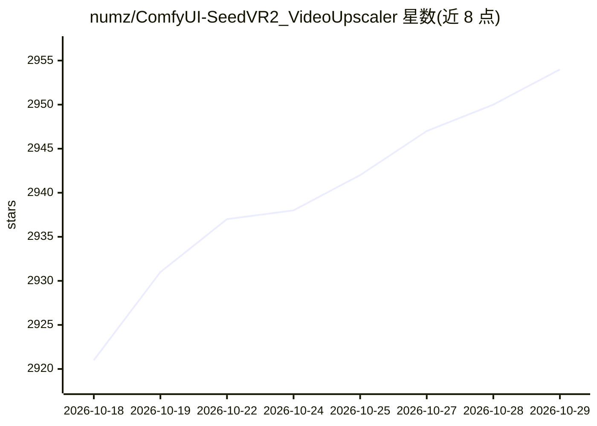

# numz/ComfyUI-SeedVR2_VideoUpscaler

⭐ 2,954 · Python · Apache-2.0 · 推送 2025-12-24 · [GitHub](https://github.com/numz/ComfyUI-SeedVR2_VideoUpscaler) · 组织维护

**ComfyUI 的 SeedVR2 视频与图像超分/放大节点**

ByteDance SeedVR2 模型在 ComfyUI 中的官方封装，以自定义节点形式对视频和图像执行超分辨率/放大处理；同时提供可独立运行的多 GPU CLI。关键机制：支持 CUDA、ROCm 与 Apple Silicon MPS 后端，多 GPU 帧级并行与流式分块处理长视频，Flash Attention/SageAttention/CUDNN 等注意力后端自动降级，模型缓存（DiT/VAE）、BlockSwap 显存管理与 GGUF 量化 VAE 支持。CLI 支持 FFmpeg 后端 x265 10-bit 输出。版本更新频繁，主要以发布说明形式在 README 中呈现。

## 筛选速览

| 维度 | 判定 | 备注 |
|---|---|---|
| AI 角色 | `ai-native` | 本体是模型或模型工具 |
| 许可风险 | `permissive` | Apache-2.0 |
| 部署形态 | `desktop` | 安装包/桌面程序 |
| 模型依赖 | — | README 未给出锁定关系 |
| 硬件要求 | — | 无带数字的原话,不猜 |
| 安装摩擦 | `medium` | 含编译或系统依赖之一 |
| 成熟度 | — | 结构信号不足 |

## 能力要点

- ComfyUI 节点 + 多 GPU 独立 CLI 双形态运行
- 支持 CUDA/ROCm/Apple Silicon MPS 三类后端
- 流式分块处理任意长度视频，含模型缓存与时间重叠混合
- Flash Attention 2/3、SageAttention、CUDNN 注意力后端自动降级链

## 适用场景

- 在 ComfyUI 工作流中放大低分辨率视频或图像
- 用多 GPU CLI 批量超分长视频
- 在显存有限的机器上用 BlockSwap 与 GGUF 量化 VAE 运行模型

## 场景标签

`图像视频处理` · 领域:感知与多模态

## 证据(README 行号)

> L5: Official release of SeedVR2 for ComfyUI that enables high-quality video and image upscaling.
> L7: Can run as **Multi-GPU standalone CLI** too, see 🖥️ Run as Standalone section.

## 星数曲线

2026-10-18 2,921 → 2026-10-29 2,954（+33）

---
*卡片 v1 · prompt 1.4 · 生成 2026-10-21 · 置信度 mid · 依据 README sha `ff73e0433a9d` · [字段定义](../../DATASET.md)*
