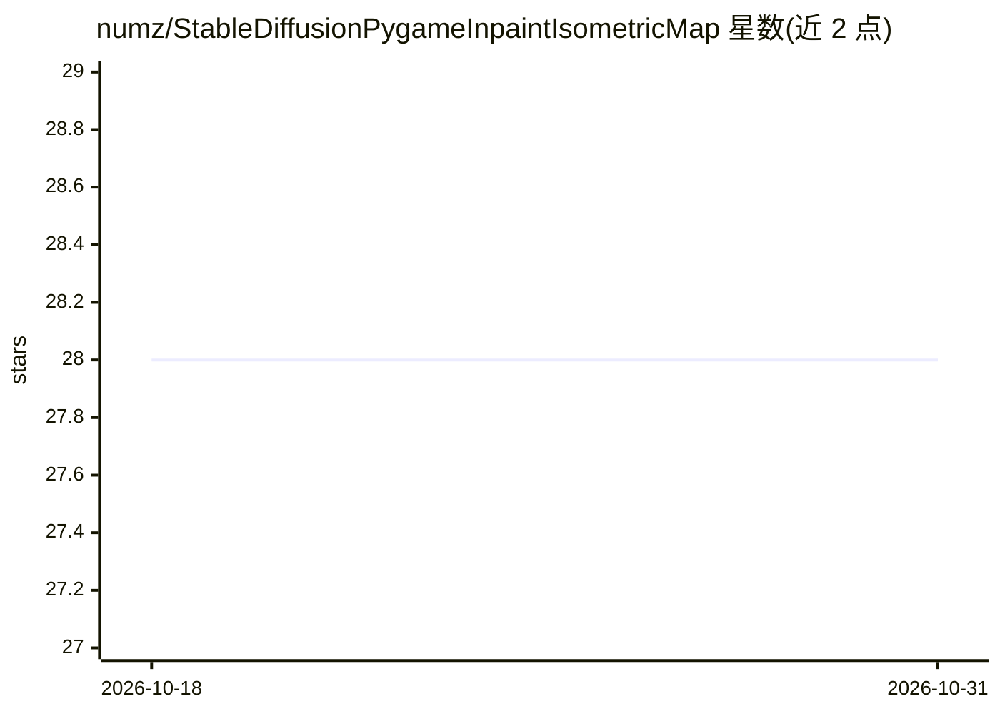

# numz/StableDiffusionPygameInpaintIsometricMap

⭐ 28 · Python · MIT · 推送 2026-08-04 · [GitHub](https://github.com/numz/StableDiffusionPygameInpaintIsometricMap) · 个人维护

**用 Stable Diffusion 在 Pygame 等距地图游戏内生成自定义图形与动画的技术演示**

开源技术演示：基于 Pygame 的等距地图游戏，在游戏内绘制形状（Shift+左键创建元素、Ctrl+左键创建动画）、输入 prompt 后调用本地 Automatic1111 Stable Diffusion WebUI（需以 --api 启动）的 img2img 接口，生成或替换地图上的图形元素并为水、火、岩浆、烟雾等元素生成动画帧。默认 prompt 模板与 payload 可在 Config/config.py 和 payloads/payload.json 中编辑。演示使用 v1-5-pruned-emaonly.ckpt 模型，MIT 许可，处于技术演示阶段（含待办事项如 Tile 编辑器）。

## 筛选速览

| 维度 | 判定 | 备注 |
|---|---|---|
| AI 角色 | `ai-native` | 本体是模型或模型工具 |
| 许可风险 | `permissive` | MIT |
| 部署形态 | `library` | 以包/库形式分发 |
| 模型依赖 | — | README 未给出锁定关系 |
| 硬件要求 | — | 无带数字的原话,不猜 |
| 安装摩擦 | `low` | 无编译、无系统依赖或容器化 |
| 成熟度 | `idea` | |

## 能力要点

- 游戏内绘制形状并以 prompt 调用 Stable Diffusion img2img 生成地图元素
- 为水/火/岩浆/烟雾/云等元素生成动画
- 通过 Automatic1111 WebUI --api 接口调用本地 Stable Diffusion
- prompt 模板与 payload 可在配置文件中编辑

## 适用场景

- 在等距地图游戏中自定义图形元素外观
- 为地图中的水、火等元素生成动画
- 学习 Pygame 与 Stable Diffusion API 集成的技术方案

## 场景标签

`图像生成` · 领域:内容生成

## 证据(README 行号)

> L5: This technical demo is an open-source project that allows users to customize the appearance and design of the map in
> L17: - Create your own map with stable diffusion
> L37: 1. Launch Stable diffusion webui with "--api" flag

## 星数曲线

2026-10-18 28 → 2026-10-31 28（+0）

---
*卡片 v1 · prompt 1.4 · 生成 2026-10-26 · 置信度 high · 依据 README sha `a8ecd8103d4c` · [字段定义](../../DATASET.md)*
