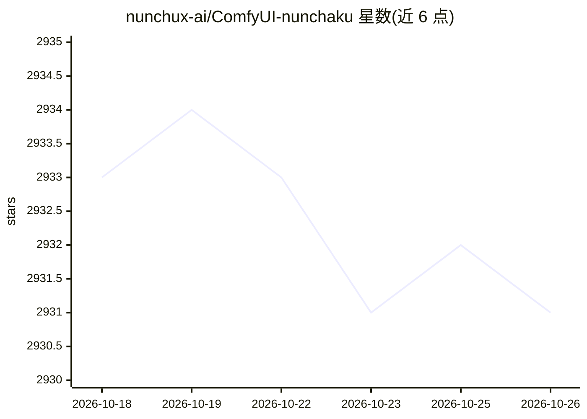

# nunchux-ai/ComfyUI-nunchaku

⭐ 2,931 · Python · Apache-2.0 · 推送 2026-09-06 · [GitHub](https://github.com/nunchux-ai/ComfyUI-nunchaku) · [官网](https://nunchaku.tech/docs/ComfyUI-nunchaku/) · 组织维护 · 中文 README

**Nunchaku 4-bit 推理引擎的 ComfyUI 插件，低显存跑图**

为 ComfyUI 提供接入 Nunchaku 推理引擎的节点插件：Nunchaku 面向 SVDQuant 4-bit 量化神经网络的推理，配套 DeepCompressor 量化库。插件支持 FLUX.1 系列、Qwen-Image 与图像编辑、Z-Image-Turbo 等 4-bit 模型的加载与推理，覆盖 LoRA（含多 LoRA）、ControlNet（Union-Pro 2.0）、PuLID、多 batch 推理、异步 offloading（Transformer 显存可低至 3 GiB）等特性，并提供内置 wheel 安装节点与预量化模型下载（Hugging Face/ModelScope）。

## 筛选速览

| 维度 | 判定 | 备注 |
|---|---|---|
| AI 角色 | `ai-ecosystem` | LLM/agent 周边工具 |
| 许可风险 | `permissive` | Apache-2.0 |
| 部署形态 | `None` |  |
| 模型依赖 | — | README 未给出锁定关系 |
| 硬件要求 | — | 无带数字的原话,不猜 |
| 安装摩擦 | `low` | 无编译、无系统依赖或容器化 |
| 成熟度 | — | 结构信号不足 |

## 能力要点

- 以 ComfyUI 节点形式接入 Nunchaku 4-bit 推理引擎
- 支持 FLUX.1、Qwen-Image/Edit、Z-Image-Turbo 等 4-bit 模型
- LoRA/多 LoRA、ControlNet、PuLID、多 batch 推理支持
- 异步 offloading 可将 Transformer 显存占用降至约 3 GiB

## 适用场景

- 在 ComfyUI 工作流中用 4-bit 量化模型做文生图/图像编辑
- 低显存 GPU 上运行 FLUX/Qwen-Image 级别模型
- 通过内置 NunchakuWheelInstaller 节点安装对应推理轮子

## 场景标签

`图像生成` `推理引擎` `模型量化` · 领域:内容生成

## 证据(README 行号)

> L7: This repository provides the ComfyUI plugin for **Nunchaku**, an efficient inference engine for 4-bit neural network
> L11: # Nunchaku ComfyUI Plugin

## 星数曲线

2026-10-18 2,933 → 2026-10-26 2,931（-2）

---
*卡片 v1 · prompt 1.4 · 生成 2026-10-21 · 置信度 high · 依据 README sha `22d8d5fdf2df` · [字段定义](../../DATASET.md)*
