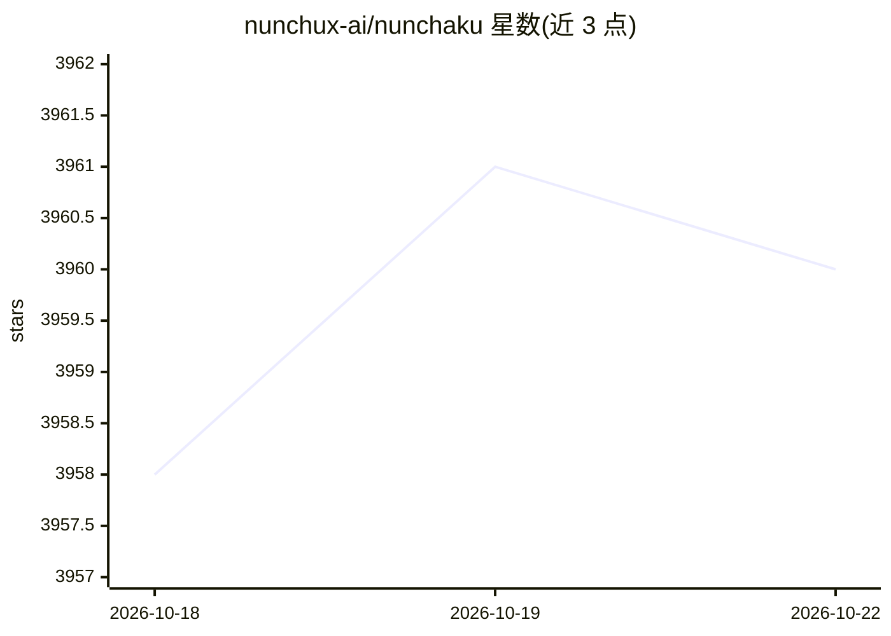

# nunchux-ai/nunchaku

⭐ 3,959 · Python · Apache-2.0 · 推送 2026-09-06 · [GitHub](https://github.com/nunchux-ai/nunchaku) · [官网](nunchux.ai) · 组织维护 · 中文 README

**4-bit 神经网络高性能推理引擎，加速扩散模型显存与速度**

Nunchaku 是面向低比特神经网络的推理引擎，实现 ICLR 2025 Spotlight 论文 SVDQuant 的 4-bit 权重与激活后训练量化技术。机制上先将激活离群值迁移到权重，再用 SVD 分解出 16-bit 低秩分支吸收离群值，并通过内核融合降低低秩分支的数据搬运开销。支持 FLUX.1、Qwen-Image、SANA、Z-Image 等扩散模型的 4-bit 推理，兼容 ComfyUI 节点、LoRA、ControlNet；量化库由配套项目 DeepCompressor 提供，面向需要本地运行扩散模型的开发者与研究者。

## 筛选速览

| 维度 | 判定 | 备注 |
|---|---|---|
| AI 角色 | `ai-ecosystem` | LLM/agent 周边工具 |
| 许可风险 | `permissive` | Apache-2.0 |
| 部署形态 | `None` |  |
| 模型依赖 | — | README 未给出锁定关系 |
| 硬件要求 | — | 无带数字的原话,不猜 |
| 安装摩擦 | `low` | 无编译、无系统依赖或容器化 |
| 成熟度 | — | 结构信号不足 |

## 能力要点

- SVDQuant 4-bit 量化：FLUX.1-dev 显存降低约 3.6×，无 CPU offloading 时端到端加速
- 内核融合的低秩分支优化设计，降低 16-bit 分支延迟开销
- 支持 ComfyUI 插件、多 LoRA、ControlNet、NVFP4（RTX 5090）
- 配套 DeepCompressor 提供自定义模型量化流程

## 适用场景

- 在消费级/笔记本 GPU 上低显存运行 FLUX、Qwen-Image 等扩散模型
- 通过 ComfyUI 节点在现有工作流中使用 4-bit 模型
- 对自己的扩散模型做 4-bit 量化并部署推理

## 场景标签

`推理引擎` `模型量化` `图像生成` · 领域:内容生成

## 证据(README 行号)

> L7: **Nunchaku** is a high-performance inference engine optimized for 4-bit neural networks, as introduced in our paper 
> L45: **Nunchaku** is a high-performance inference engine for low-bit neural networks. It implements **SVDQuant**, a post
> L61: engine (a) Naïvely running low-rank branch with rank 32 will introduce 57% latency overhead due to extra read of 16

## 星数曲线

2026-10-18 3,958 → 2026-10-22 3,960（+2）

---
*卡片 v1 · prompt 1.4 · 生成 2026-10-20 · 置信度 high · 依据 README sha `6041077066c9` · [字段定义](../../DATASET.md)*
