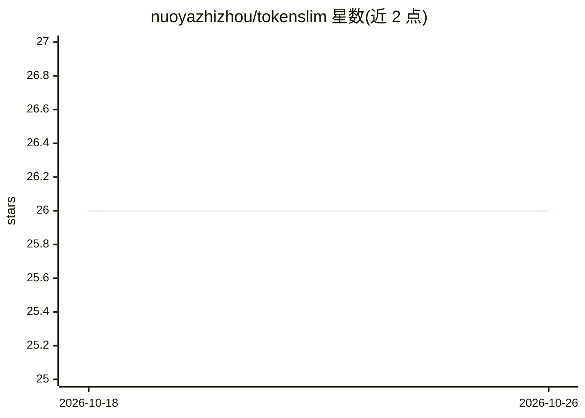

# nuoyazhizhou/tokenslim

⭐ 26 · Rust · MIT · 推送 2026-09-11 · [GitHub](https://github.com/nuoyazhizhou/tokenslim) · [官网](https://www.npmjs.com/package/tokenslim) · 个人维护 · 中文 README

**面向 LLM 输入的 Rust token 压缩引擎，含 CLI/服务器/SDK**

用 Rust 编写的插件式文本压缩引擎，压缩构建日志、CI 日志、云日志、VCS 输出等 LLM 输入内容，宣称结构化重复输入可减 50–90%、AI Export 模式可达 90–95%。核心机制包括零拷贝并行流水线（宣称 100MB 约 250ms）、基数字典树路径提取、60+ 插件识别各输入家族、环境诊断工具与编码回退链。提供 CLI、REST 服务器（含内嵌 Web UI）、Java/Python/Node SDK 与 IDE 扩展目录。面向需将长日志喂给 LLM 的开发者和 CI/Agent 工作流。

## 筛选速览

| 维度 | 判定 | 备注 |
|---|---|---|
| AI 角色 | `ai-ecosystem` | LLM/agent 周边工具 |
| 许可风险 | `permissive` | MIT |
| 部署形态 | `desktop` | 安装包/桌面程序 |
| 模型依赖 | — | README 未给出锁定关系 |
| 硬件要求 | — | 无带数字的原话,不猜 |
| 安装摩擦 | `low` | 无编译、无系统依赖或容器化 |
| 成熟度 | — | 结构信号不足 |

## 能力要点

- 60+ 插件覆盖构建/云/CI/VCS 等日志类型
- 三种运行时：CLI、REST Server（内嵌 Web UI）、多语言 SDK
- --ai-export / --ai-signal 两种面向 LLM 的输出模式
- 环境诊断与编码回退链，支持多语言混合环境

## 适用场景

- 压缩 CI/构建日志以降低 LLM API 输入 token 成本
- 把超长日志塞进有限的 LLM 上下文窗口
- 在 IDE 或 CI 流水线中通过 sidecar 服务批量压缩输入
- 诊断多语言环境下的乱码与编码配置问题

## 场景标签

 · 领域:LLM 工具链/文本压缩

## 证据(README 行号)

> L3:  High-performance Rust token compression engine for LLM inputs.
> L24: TokenSlim is a high-performance, plugin-based text compression engine written in Rust. Its core mission is to **dra
> L117:  - **SDKs** — Java, Python (PyO3), Node.js

## 星数曲线

2026-10-18 26 → 2026-10-26 26（+0）

---
*卡片 v1 · prompt 1.4 · 生成 2026-10-26 · 置信度 mid · 依据 README sha `cb928cb61ce7` · [字段定义](../../DATASET.md)*
