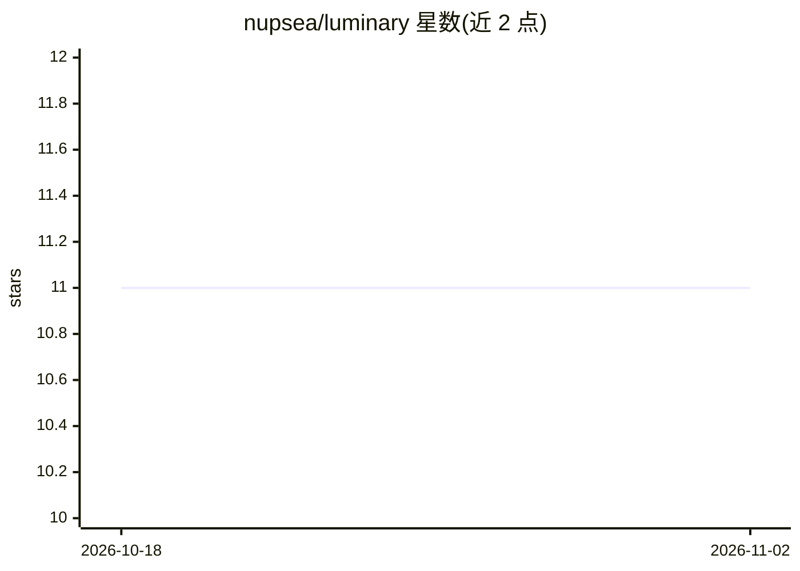

# nupsea/luminary

⭐ 11 · Python · Apache-2.0 · 推送 2026-11-01 · [GitHub](https://github.com/nupsea/luminary) · 组织维护

**本地优先的个人学习工作区：文档问答、笔记与 FSRS 闪卡复习**

面向个人学习者的桌面应用：导入 PDF/EPUB/音频/网页等文档建立本地知识库，提供带引用定位的问答（混合检索：向量+关键词+图谱）、Markdown 笔记、生成闪卡并用 FSRS 排期复习，含预测校准与教学回练模式。默认本地运行 LLM，模型随首次启动下载（约 1.5–3.4 GB）；也可在设置中填入 Anthropic/OpenAI/Google API key 改用托管模型，此模式下仅问题与检索片段离开本机。要求 Apple Silicon 或配 NVIDIA/AMD 显卡且 16 GB 以上内存，Intel Mac 与核显机器不支持本地模型。

## 筛选速览

| 维度 | 判定 | 备注 |
|---|---|---|
| AI 角色 | `ai-native` | 本体是模型或模型工具 |
| 许可风险 | `permissive` | Apache-2.0 |
| 部署形态 | `desktop` | 安装包/桌面程序 |
| 模型依赖 | — | README 未给出锁定关系 |
| 硬件要求 | — | 无带数字的原话,不猜 |
| 安装摩擦 | `low` | 无编译、无系统依赖或容器化 |
| 成熟度 | — | 结构信号不足 |

## 能力要点

- 答案附引用，点击定位到原文段落，引文为原文而非模型复述
- 闪卡引文会与文档核对，无法核对的卡片会标注
- 混合检索（向量+关键词+图谱）与 FSRS 复习排期
- 默认离线运行，库为单一文件夹可迁移，可导出 Obsidian 兼容 vault 与 Anki apkg

## 适用场景

- 把论文、书籍、视频整理成本人知识库并带出处提问
- 用闪卡与 FSRS 排期复习文档要点并校准自我评估
- 离线阅读、做笔记、划重点并全文搜索

## 场景标签

`文档问答` `知识库管理` · 领域:知识与检索

## 证据(README 行号)

> L13: Point it at a book, paper, video or article. Ask questions and get answers that cite the passage,
> L151: |**Ask**|Hybrid retrieval (vector + keyword + graph), Socratic mode, teach-back|
> L152: |**Study**|Regular, cloze and code-trace cards; FSRS; prediction calibration|

## 星数曲线

2026-10-18 11 → 2026-11-02 11（+0）

---
*卡片 v1 · prompt 1.4 · 生成 2026-11-01 · 置信度 high · 依据 README sha `039e95a3bd41` · [字段定义](../../DATASET.md)*
