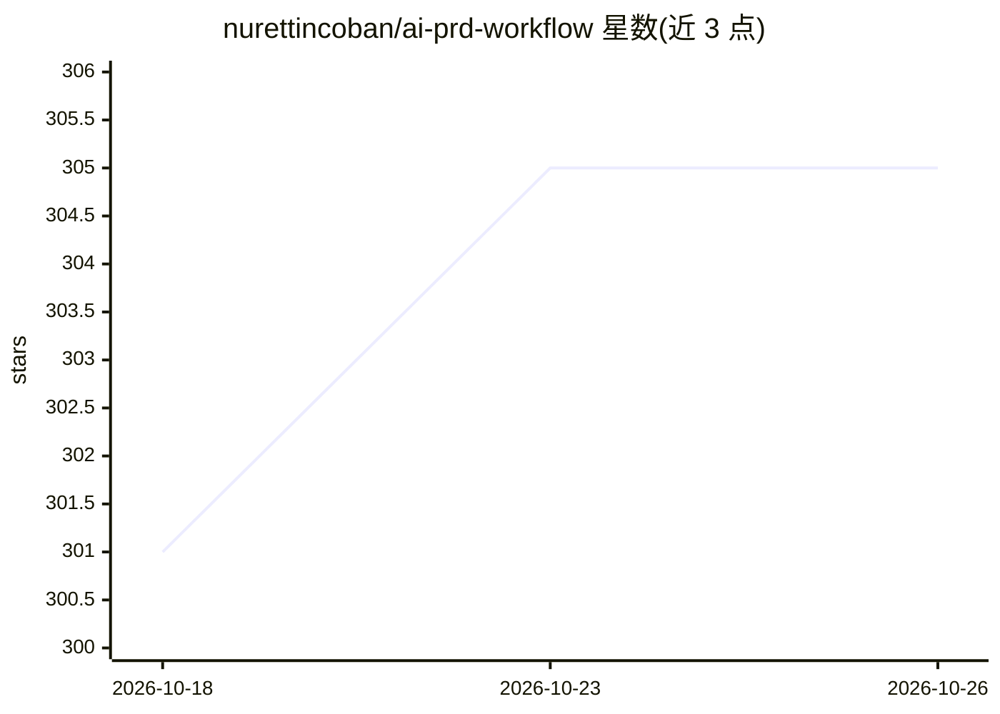

# nurettincoban/ai-prd-workflow

⭐ 305 · Python · MIT · 推送 2026-10-08 · [GitHub](https://github.com/nurettincoban/ai-prd-workflow) · [官网](https://nurettincoban.github.io/ai-prd-workflow/) · 个人维护 · 中文 README

**面向 AI 编码代理的 RFC 驱动开发工作流技能集**

以 Agent Skills 形式提供的一套斜杠命令工作流：从想法或既有代码出发，经访谈生成 PRD，逐步产出 FEATURES.md、RULES.md、按依赖顺序排列的小 RFC、测试策略与实现审查，每步写 markdown 文件供下一步读取，决策可跨会话留存。附带 scripts/trace-check.py 检查文档间引用一致性。支持 Claude Code 插件安装，或经 install.sh 安装到 Codex、Copilot、Cursor、Gemini CLI、OpenCode、Devin 等工具，也可复制提示词在任意聊天助手中使用。

## 筛选速览

| 维度 | 判定 | 备注 |
|---|---|---|
| AI 角色 | `ai-ecosystem` | LLM/agent 周边工具 |
| 许可风险 | `permissive` | MIT |
| 部署形态 | `None` |  |
| 模型依赖 | — | README 未给出锁定关系 |
| 硬件要求 | — | 无带数字的原话,不猜 |
| 安装摩擦 | `low` | 无编译、无系统依赖或容器化 |
| 成熟度 | — | 结构信号不足 |

## 能力要点

- 访谈→PRD→特性→规则→RFC→实现→审查的完整命令链（/create-prd 至 /workflow-status）
- 每步输出 markdown 文件，决策跨会话、跨工具留存
- trace-check.py 脚本校验 ID 引用与文件间一致性
- 支持 7 种 AI 编码工具安装及任意聊天助手的提示词使用方式

## 适用场景

- 用 AI 编码代理做数周规模的多特性项目，先定范围再写码
- 把需求、规则与 RFC 固化为文件，避免决策随会话丢失
- 变更时检查与历史决策和规则的冲突并同步更新所有文件

## 场景标签

`提示工程` · 领域:Agent 开发

## 证据(README 行号)

> L38: **Codex, GitHub Copilot, Cursor, Gemini CLI, OpenCode or Devin** — install the skills into your project:
> L41: curl -fsSL https://raw.githubusercontent.com/nurettincoban/ai-prd-workflow/main/install.sh | bash -s -- /path/to/yo
> L81: |`/create-prd`|Interviews you about the idea, a few questions at a time|`PRD.md`|view|

## 星数曲线

2026-10-18 301 → 2026-10-26 305（+4）

---
*卡片 v1 · prompt 1.4 · 生成 2026-10-22 · 置信度 high · 依据 README sha `79afe7270e60` · [字段定义](../../DATASET.md)*
