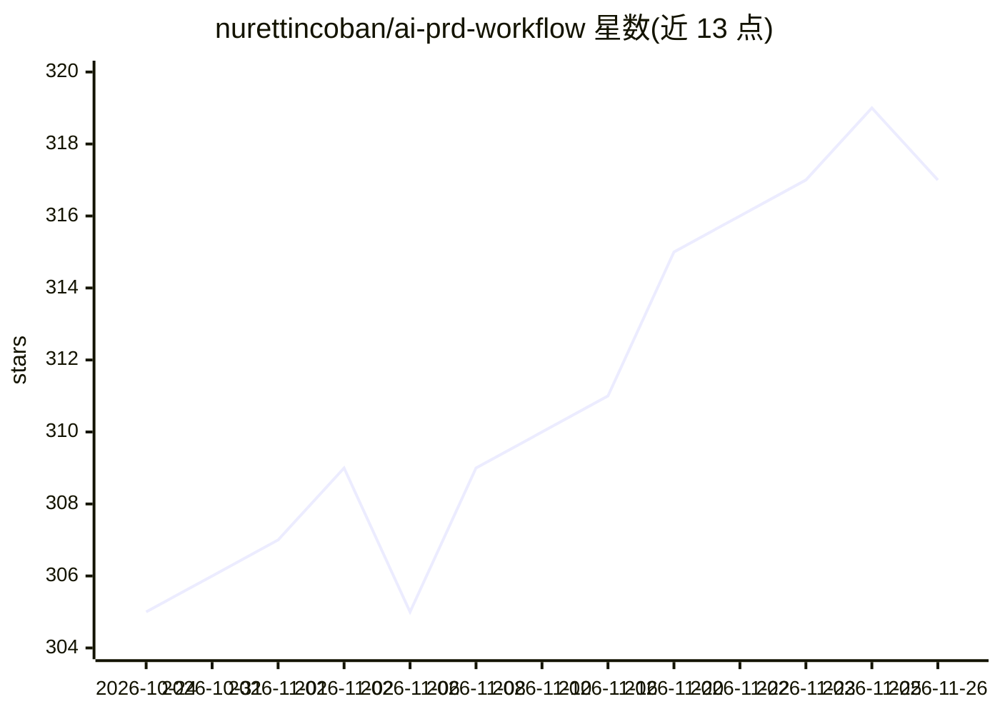

# nurettincoban/ai-prd-workflow

⭐ 317 · Python · MIT · 推送 2026-11-17 · [GitHub](https://github.com/nurettincoban/ai-prd-workflow) · [官网](https://nurettincoban.github.io/ai-prd-workflow/) · 个人维护 · 中文 README

**为 AI 编码代理提供 PRD→RFC 流程规范的工作流技能集**

一组以提示形式安装到 AI 编码工具的 Agent Skills，把想法或既有代码库推进为经校验的 PRD、带 ID 的特性清单、项目规则、按依赖排序的 RFC，再逐条实现并审查。每步产出 markdown 文件供下一步读取，脚本检查跨文档一致性与 ID 引用。以 Claude Code 插件或 install.sh 脚本安装，命令即普通提示，无 CLI、无框架依赖。

## 筛选速览

| 维度 | 判定 | 备注 |
|---|---|---|
| AI 角色 | `ai-ecosystem` | LLM/agent 周边工具 |
| 许可风险 | `permissive` | MIT |
| 部署形态 | `None` |  |
| 模型依赖 | — | README 未给出锁定关系 |
| 硬件要求 | — | 无带数字的原话,不猜 |
| 安装摩擦 | `low` | 无编译、无系统依赖或容器化 |
| 成熟度 | — | 结构信号不足 |

## 能力要点

- /verify-prd 在写代码前发现规格中的缺口与矛盾
- 特性/规则/RFC 通过永久 ID 互相引用，trace-check.py 脚本校验引用一致性
- 支持 Claude Code、Codex、Copilot、Cursor、Gemini CLI、OpenCode、Devin 等工具
- /implement-rfc 先出计划等用户批准再写码，/review-rfc 在独立上下文审查

## 适用场景

- 用 AI 编码代理开发多周规模项目时管理需求与决策记录
- 为既有代码库补齐文档后增量添加功能
- 在多会话、多模型、多工具之间保持项目决策不丢失

## 场景标签

`提示工程` `编码 Agent` · 领域:Agent 开发

## 证据(README 行号)

> L17: AI coding agents write code well. They are worse at deciding what to build, remembering yesterday's decisions, and 
> L19: Every step writes a markdown file that the next step reads, so decisions outlive the chat session. A script checks 

## 星数曲线

2026-10-24 305 → 2026-11-26 317（+12）

---
*卡片 v1 · prompt 1.4 · 生成 2026-11-25 · 置信度 high · 依据 README sha `5012665ff63b` · [字段定义](../../DATASET.md)*
