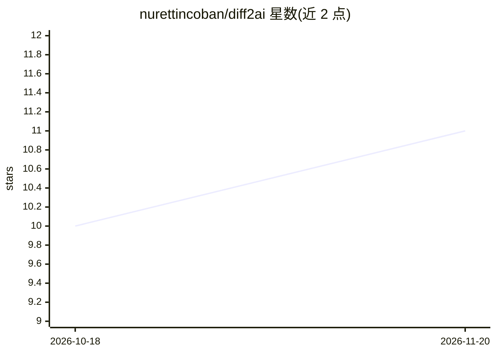

# nurettincoban/diff2ai

⭐ 11 · TypeScript · MIT · 推送 2026-11-13 · [GitHub](https://github.com/nurettincoban/diff2ai) · [官网](https://nurettincoban.github.io/diff2ai/) · 个人维护

**给开发者的 AI 代码评审 CLI：把 Git diff 编排为可溯源的评审**

npm 分发的 Node.js CLI，读取 Git diff 并构建带行号、提交信息与文件摘要的结构化评审提示，交给用户已安装的 AI CLI 执行（claude/codex/gemini/opencode/cursor/ollama 等），也可仅复制提示。支持多人格评审并行加 judge 校验与本地机械比对降级未证实发现，通过 gh/glab 在 GitHub PR 行内或 GitLab MR 发表评论，提供 GitHub Action、SARIF 导出与严重级别门禁。纯本地 git 运行，不自带 AI 服务。

## 筛选速览

| 维度 | 判定 | 备注 |
|---|---|---|
| AI 角色 | `ai-ecosystem` | LLM/agent 周边工具 |
| 许可风险 | `permissive` | MIT |
| 部署形态 | `library` | 以包/库形式分发 |
| 模型依赖 | local-ok | 支持本地模型 |
| 硬件要求 | — | 无带数字的原话,不猜 |
| 安装摩擦 | `low` | 无编译、无系统依赖或容器化 |
| 成熟度 | — | 结构信号不足 |

## 能力要点

- --run 接入 6 种 AI CLI，含本地 ollama:<model>
- 多评审人格共识 + judge 校验 + 零 token 机械 diff 复核
- GitHub PR 行内评论与 GitLab MR 笔记（经用户自己的 gh/glab）
- SARIF 导出、--fail-on 严重级别门禁与 GitHub Action

## 适用场景

- 在 CI 中对每个 PR 自动跑 AI 评审并发表行内评论
- 大 diff 按文件/hunk 分批构建提示交给本地模型评审
- 推送前用 pre-push hook 快速审查待推改动

## 场景标签

`代码审查` · 领域:编码与开发

## 证据(README 行号)

> L12: Turn your Git diffs into high-signal AI code reviews — with the AI you already use, locally, from your terminal or 
> L14: - 🤖 **Any AI CLI**: `--run claude | codex | gemini | opencode | cursor | ollama:<model>` — or just copy the prompt 
> L60: `--run <runner>` hands the generated prompt to an AI CLI:

## 星数曲线

2026-10-18 10 → 2026-11-20 11（+1）

---
*卡片 v1 · prompt 1.4 · 生成 2026-11-19 · 置信度 high · 依据 README sha `59706988b35a` · [字段定义](../../DATASET.md)*
