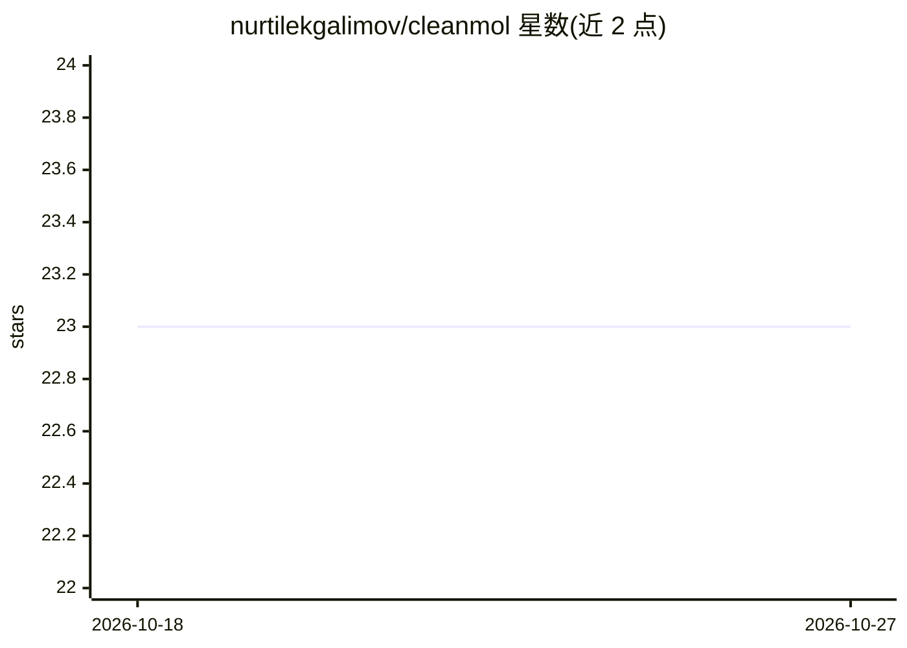

# nurtilekgalimov/cleanmol

⭐ 23 · Python · MIT · 推送 2026-04-15 · [GitHub](https://github.com/nurtilekgalimov/cleanmol) · 个人维护

**给药物发现/化学信息学研究者的 SMILES 数据集清洗标准化工具**

基于 RDKit 的 Python CLI 与库，对 CSV 化学数据集执行 SMILES 校验、规范化、去盐、最大片段保留、标准化与去重，各步骤按配置可选开启。每步变更写入 JSON 审计报告，记录哪些行被删除及原因，保证相同输入加相同配置得到相同输出。以 pip 源码方式安装（需 Python 3.10+ 与 RDKit），提供 cleanmol 命令行与 CleanMolPipeline 编程接口。限制：当前整表载入内存，超大文件需外部 sort 或分块处理；去盐为启发式，支持自定义 SMARTS 盐定义。

## 筛选速览

| 维度 | 判定 | 备注 |
|---|---|---|
| AI 角色 | `ai-ecosystem` | LLM/agent 周边工具 |
| 许可风险 | `permissive` | MIT |
| 部署形态 | `library` | 以包/库形式分发 |
| 模型依赖 | — | README 未给出锁定关系 |
| 硬件要求 | — | 无带数字的原话,不猜 |
| 安装摩擦 | `low` | 无编译、无系统依赖或容器化 |
| 成熟度 | — | 结构信号不足 |

## 能力要点

- validate→canonicalize→desalt→normalize→deduplicate 的可选流水线
- JSON 审计报告记录每行变更与删除原因
- CLI 与 Python API 双入口，支持自定义盐 SMARTS 文件
- 处理结果确定可复现，无静默失败

## 适用场景

- 训练 QSAR/指纹相似度/生成模型前清洗 ChEMBL、PubChem 等数据集
- 对内部 HTS 数据做可审计的规范化与去重
- 用自定义盐定义文件适配特定化学体系的去盐需求

## 场景标签

`科研工具` · 领域:学习与行业

## 证据(README 行号)

> L5: CleanMol is a small, modular Python tool that turns messy chemical datasets
> L20: If you train a QSAR model, fingerprint similarity search, or generative

## 星数曲线

2026-10-18 23 → 2026-10-27 23（+0）

---
*卡片 v1 · prompt 1.4 · 生成 2026-10-27 · 置信度 mid · 依据 README sha `9c260ac7a719` · [字段定义](../../DATASET.md)*
