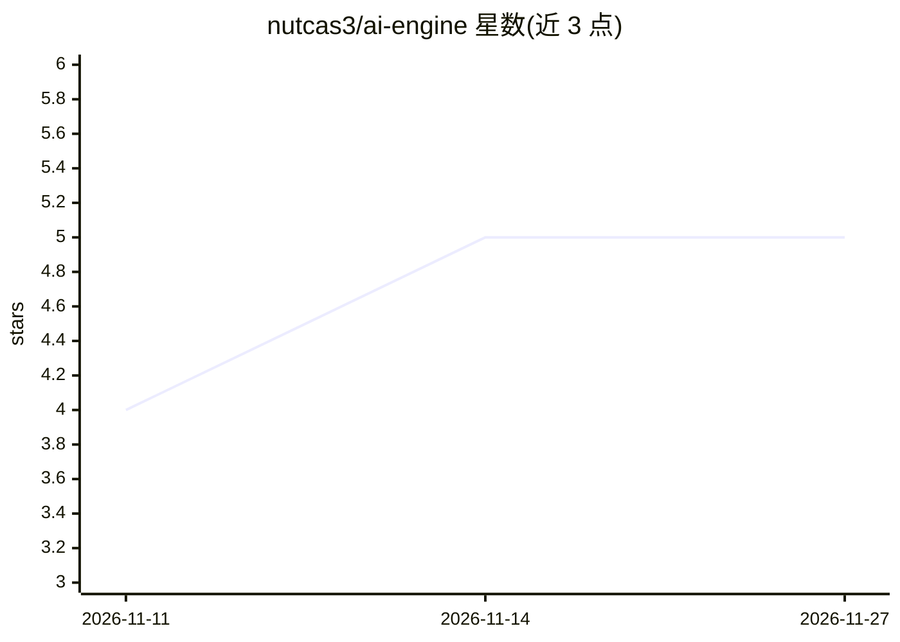

# nutcas3/ai-engine

⭐ 5 · Go · 推送 2026-11-10 · [GitHub](https://github.com/nutcas3/ai-engine) · 个人维护

**GPU 集群控制平面：单一 Go 二进制提供遥测与节点运维仪表盘**

用 Go 编写的云中立 AI 基础设施控制平面，以单个二进制运行 templ + htmx 仪表盘，提供 GPU 集群遥测（SSE 每 2 秒推送指标）、节点排水（drain）修复操作以及多云节点池供给（AWS/CAPA、CoreWeave、本地 Metal3 等 provider 适配器，未配置时仅 Mock 可用）。支持环境变量白标重品牌（名称/Logo/主题）。面向管理 GPU 基础设施的运维者，通过 make build、go install 或发布二进制/容器镜像安装。

## 筛选速览

| 维度 | 判定 | 备注 |
|---|---|---|
| AI 角色 | `ai-ecosystem` | LLM/agent 周边工具 |
| 许可风险 | `none` | — |
| 部署形态 | `library` | 以包/库形式分发 |
| 模型依赖 | — | README 未给出锁定关系 |
| 硬件要求 | — | 无带数字的原话,不猜 |
| 安装摩擦 | `low` | 无编译、无系统依赖或容器化 |
| 成熟度 | — | 结构信号不足 |

## 能力要点

- 单一 Go 二进制内嵌 templ + htmx 仪表盘，无 JS 框架
- SSE 实时推送 GPU 节点遥测指标（每 2 秒）
- 节点 drain 操作与多云节点池 provision 的 provider 适配器架构
- 通过环境变量实现白标重品牌（品牌名/Logo/主题）

## 适用场景

- 管理跨 AWS/CoreWeave/本地机房的 GPU 节点舰队
- 在仪表盘上监控 GPU 指标并对降级节点执行排水修复
- 为多云 GPU 环境供给新的节点池
- 以自有品牌部署 GPU 控制平面界面

## 场景标签

 · 领域:AI 基础设施/GPU 集群管理

## 证据(README 行号)

> L3: Cloud-agnostic AI engine control plane — a single Go binary serving a
> L4: templ + htmx dashboard for GPU fleet telemetry, node remediation, and
> L11: - **Go** stdlib `net/http` — control-plane API

## 星数曲线

2026-11-11 4 → 2026-11-27 5（+1）

---
*卡片 v1 · prompt 1.4 · 生成 2026-11-21 · 置信度 mid · 依据 README sha `5b8494a70b9c` · [字段定义](../../DATASET.md)*
