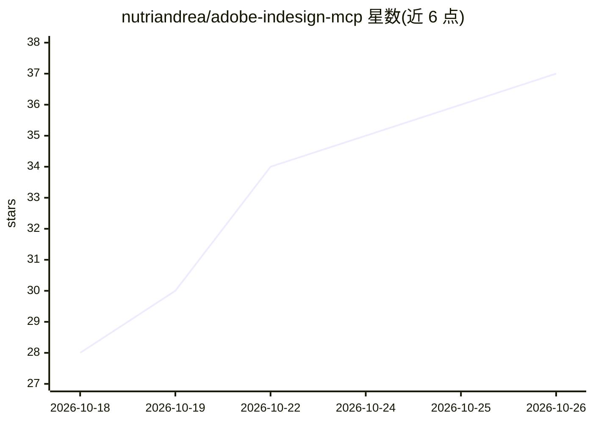

# nutriandrea/adobe-indesign-mcp

⭐ 37 · TypeScript · MIT · 推送 2026-10-20 · [GitHub](https://github.com/nutriandrea/adobe-indesign-mcp) · [官网](https://github.com/nutriandrea/adobe-indesign-mcp) · 个人维护

**让 AI agent 通过自然语言驱动 Adobe InDesign 排版的 MCP 服务器**

面向使用 MCP 协议 AI agent 的 Node.js 服务器，提供 197 个工具、34 个处理器，覆盖 InDesign 文本排版、图形、表格、样式、导出、XML/数据合并等 DOM 能力；架构上经 STDIO 与 agent 通信，再通过 WebSocket（端口 8120）连接本机 InDesign——macOS 可走 UXP 插件或 JXA 代理桥，Windows 用进程内 COM 桥。另附 10 个自动加载的 AI 技能（如 Word 导入、导出校验、模板管理）。需本机安装 Adobe InDesign。

## 筛选速览

| 维度 | 判定 | 备注 |
|---|---|---|
| AI 角色 | `ai-ecosystem` | LLM/agent 周边工具 |
| 许可风险 | `permissive` | MIT |
| 部署形态 | `library` | 以包/库形式分发 |
| 模型依赖 | — | README 未给出锁定关系 |
| 硬件要求 | — | 无带数字的原话,不猜 |
| 安装摩擦 | `low` | 无编译、无系统依赖或容器化 |
| 成熟度 | — | 结构信号不足 |

## 能力要点

- 197 个工具、34 个处理器，覆盖文本、表格、样式、导出、XML/数据合并等 InDesign DOM 能力
- macOS 双路径：UXP 插件面板或无插件的 JXA 代理桥；Windows 通过进程内 COM 桥
- 内置 10 个触发词自动加载的 AI 技能（Word 导入、图像优化、样式提取等）
- 提供 mcp://tools/inventory 等 MCP 资源供 agent 自发现，工具数由 CI 测试钉住

## 适用场景

- 用自然语言让 AI agent 创建和排版 InDesign 文档
- 从 CSV/Word 批量生成目录、书籍或模板变体并导出 PDF
- 出版生产中检查缺失字体、断链并执行印前预检

## 场景标签

`GUI 自动化` `工作流自动化` · 领域:效率与自动化

## 证据(README 行号)

> L119: │  Any AI Agent       │ ◄────────────────► │  indesign-nutria-mcp │ ◄───────────────► │  Adobe InDesign   │
> L126: The MCP protocol always speaks stdio. Only the last hop differs, and you pick
> L254: Both hosts start the same published package — nothing to clone, nothing to

## 星数曲线

2026-10-18 28 → 2026-10-26 37（+9）

---
*卡片 v1 · prompt 1.4 · 生成 2026-10-25 · 置信度 high · 依据 README sha `b37ac65f59e8` · [字段定义](../../DATASET.md)*
